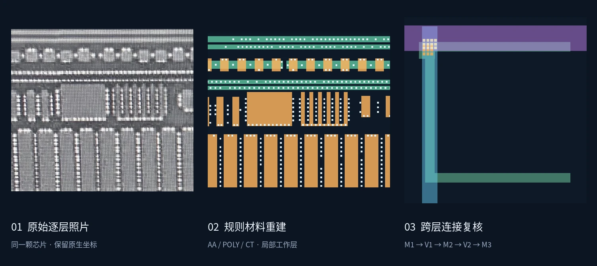
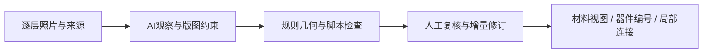

# SiliconEye

### 将模拟版图经验转化为AI可执行、可复核的重建约束。

从**同一颗芯片的8张逐层照片**出发，结合图像算法、版图结构约束与人工复核，逐步重建材料层、器件编号和跨层连接。项目由 **XIAHONGYUU** 主导需求、领域判断与验收，采用AI辅助开发。

[**打开交互Demo →**](https://xiahongyuu.github.io/SiliconEye/) · [质量纠错案例](docs/portfolio/quality-case.md) · [评测基准](benchmarks/portfolio-quality-v1/README.md) · [三个交互案例](docs/portfolio/cases.md) · [复现与开发](DEVELOPMENT.md)

## 从一次真实错误，看质量门如何改进

AI曾将六孔V1组接到窄M2-A；旧检查只验证单个代理框，漏掉了完整孔组占用。人工纠正为宽M2-B后，流程增加孔数、完整阵列和上下承载检查。[查看原错误、裁决与修订证据](docs/portfolio/quality-case.md)。

| 有范围的结果 | 口径 |
| --- | --- |
| AA三项历史任务验收通过 | 接续、局部改善、防退化；同Agent已知案例，非新模型准确率 |
| 8个历史任务已整理 | 2个沿用现有机器评分器、6个人工rubric；同一颗芯片，留出任务0 |
| 2条失败记录公开呈现 | POLY计数5→6；V1承载窄A→宽B。不是全项目失败总数 |
| 工作层AA334 / POLY696 / CT10287 | 重建对象数；六处未知是区域，不能除以对象数当未知率 |

新模型准确率、跨芯片泛化、人审总耗时与速度改善尚未测量。[结果与来源数据](site/quality-report.json) · [评测协议](benchmarks/portfolio-quality-v1/README.md) · [公开包验证](benchmarks/portfolio-quality-v1/verification.json) · [CI配置（待启用）](docs/portfolio/ci-workflow.yml)。

## 三个案例，三分钟看懂

| 案例 | 可以看到什么 | 解决的工程问题 |
| --- | --- | --- |
| [材料规则重建](https://xiahongyuu.github.io/SiliconEye/#materials) | 切换AA、POLY、CT，比较来源照片与规则几何 | 拍摄畸变、层间材料混杂；保留真实间隙与规则孔阵列 |
| [器件编号与连接](https://xiahongyuu.github.io/SiliconEye/#devices) | 选择MOS栅指编号，联动跨层检查范围、端子表和局部电路表达 | 让照片、对象ID和已审关系可以互相追溯，未知端不自动补连 |
| [五层联合复核](https://xiahongyuu.github.io/SiliconEye/#metals) | 切换M1/V1/M2/V2/M3，放大孔组和上下承载 | 分清过孔身份与承载，允许跨层投影重叠，阻止错误合并 |

## 这个项目体现的能力

- **模拟版图理解**：区分栅端、共享扩散、环、dummy及跨层接口，将正向设计经验用于逆向重建。
- **工程流程设计**：AI负责观察与推理；脚本执行固定步骤；人工裁决关键歧义。局部修订继承已有成果，并用质量门阻止退化。
- **AI辅助开发与验证**：以真实照片持续迭代Python工具、结构化数据和交互复核页，将经验沉淀为可复用skill。

**技术栈：** Python · OpenCV · NumPy · Shapely · Pillow · HTML/SVG/JavaScript · pytest

## 当前进展

已形成AA/POLY/CT共同工作层、局部器件编号与电路表达、五层导体联合复核，以及接续和防退化工具。Demo使用实际项目的冻结数据；其中已审关系与候选几何分开标明。

当前是**一颗芯片上的人机协作研究原型**，尚未完成全芯片自动恢复、真实工艺DRC/LVS或仿真就绪网表。测试通过证明工程行为，不等同于识别准确率。

---

[开发指南](DEVELOPMENT.md) · [文档导航](docs/README.md) · [当前开发任务](CURRENT_TASK.md) · [简历项目表述](docs/portfolio/resume.md) · [样本来源说明](docs/portfolio/data-sources.md) · [README历史原文](docs/history/2026-10-25-before-portfolio-README.md)
