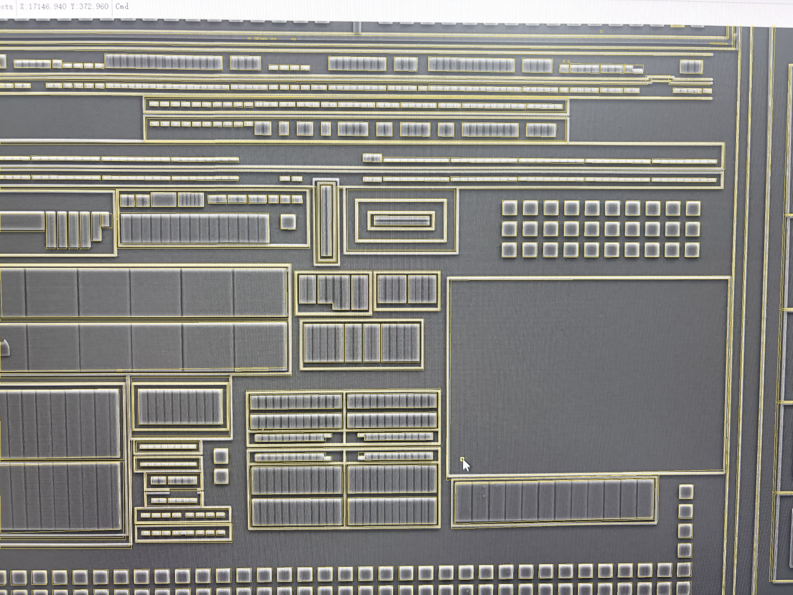
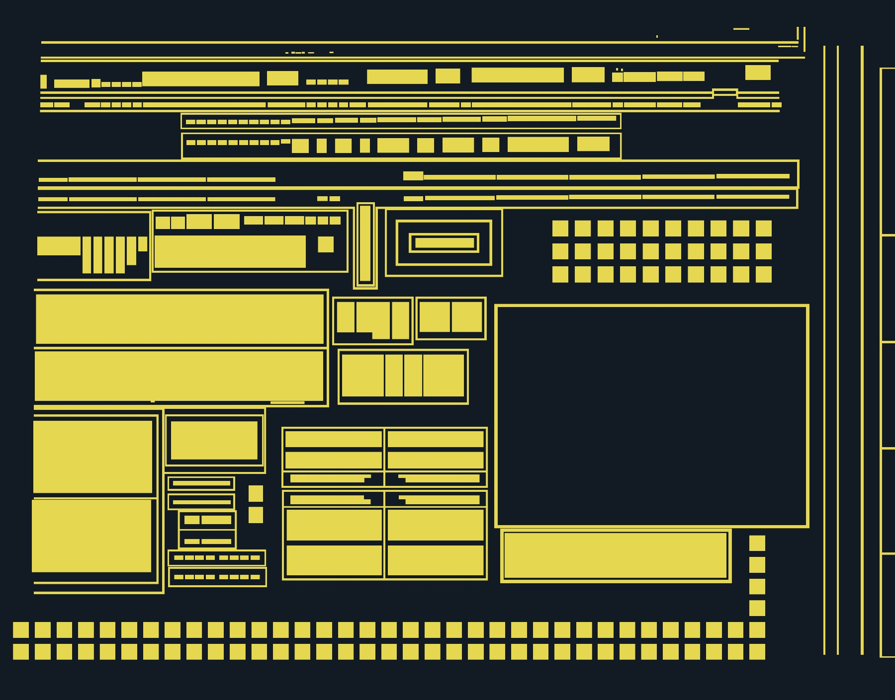

# 全幅 AA 补标与隔离修正 v1

2026-10-18，按“继续推进并修正到所有 AA 全部被标出”执行。

[打开 AA 全幅复核页](../runs/aa-completion-v1k/index.html)。默认 AA 原图与边界，可切换正交规则版图、旧版、只看新增结构、编号、透明度及 F01–F12；每窗显示上一轮人工反馈。本版不处理 CT。

本轮完成全幅 AA 的候选补标，尚未获得“所有 AA 无遗漏”的独立验收。当前 336 条记录不是独立材料岛或 MOS 数量；全部候选均采用规则正交几何，所有活动对象之间无面积交叠。真实隔离/连续性、准确边界及覆盖完整性仍须结合来源验收；软件 PASS 不代替这些结论。



## 已落实的修正

| 范围 | 修正 |
| --- | --- |
| F01–F06 | 补外围长条/环、上部两条阶梯 AA、左侧七块阶梯/指状 AA；保留环内器件与环的分离 |
| F06 | 重建中央器件及三个外围环，保留器件真实凹角，不再以矩形填平中间隔离 |
| F07–F09 | 补纵向及横向 MOS 外围保护结构，保留已有中间环和独立内岛，避免重复套环 |
| F09–F11 | 补左侧连续环、底部中间器件组、共享环边、折线 AA 和小器件区域，纠正环内场区被整块填充的问题 |
| F12 与照片右边缘 | 右侧四个纵向 dummy 按共同尺寸/节距与 D01 右列对齐；补五段仅部分可见的邻近环边和三条外侧纵向 AA |

共 25 组结构、89 条新增结构记录；56 条旧候选由完整结构替代或转存疑点，全部保留原记录及原因。另外将上部一行 25 条 AA 的设计基线/高度统一；照片边界另存，不把布局参数化当精确尺寸真值。保留样稿中的 72 条 AA 逐字段不变，123 条 CT 留在冻结父模型中，不进入本轮模型或重算。

旧 AA-F00128 的照片位置与本轮右侧第四个 dummy 对应；原先与 D01 碰撞来自不同局部/全局参数混用。[单独处理记录](../benchmarks/aa-completion-v1/boundary-disposition-v1.json)保留来源面积对应比例及新的候选编号，不覆盖旧冲突记录。



## 来源与几何的边界

AI 逐段观察原图并写入结构参数；脚本按参数构造矩形、环、折线和显式共享环边，检查有效性/正交性/面积冲突并生成图稿。本轮不是新训练模型的自动识别评测，也不将阈值分割照片直接当生产材料层。

各结构保存原照片边界对应和规则几何。长结构使用显式分轴参数化，局部照片边界另存；照片边缘的部分环采用明确的边界对应，不假装所有结构都能由一张全局单应矩阵回投。读取新对象时优先使用 `source_geometry`，其余继承对象使用原 `projection_matrices`；组编号不能直接当作一张可用的 3×3 矩阵。当前尚无经过独立验收的全幅一致畸变场，不能用这版直接判定跨层孔落点或并网。

照片裁切造成的端部只表示有效可见范围，未补出照片外的环或连接。CT/M1 断口未用作 AA 断口；AA 环内孔与器件间隔单独保留。原先 100 条轮廓初始化疑点仍冻结留档，并不等于漏了100个器件；本轮没有逐条将它们归并成已验收材料。覆盖门与独立边界门因此保持待复核，不给出虚假的召回率或“全芯片重建完成”。

## 运行与验证

```bash
.venv/bin/python -m silicon_eye.aa_completion \
  --root . --spec benchmarks/aa-completion-v1/spec-v9.json \
  --output runs/一个新的AA目录
```

[结构观察参数](../benchmarks/aa-completion-v1/spec-v9.json) · [冻结模型](../benchmarks/aa-completion-v1/model-v1.json) · [逐窗复核台账](../benchmarks/aa-completion-v1/coverage-review-v1.json) · [技术核查](../benchmarks/aa-completion-v1/verification-v1.json)。中间 spec-v1 与 runs/ 各试验快照保留调试上下文；当前可重跑参数为 spec-v9。

全项目 310 项测试通过，含 5 项 AA 专项测试：环内场区不填充、照片边界不造封口、显式共享环边、误交叠/斜边/重复 ID 拦截、保留 AA 不动和来源坐标正确取用。相关 Ruff、原图/冻结输入哈希、8 项 SVG 尺寸、页面脚本语法和静态资源核查通过。浏览器交互未自动实测，未绕过既有本地 file 预览限制。当前未提交或推送 Git。

下一节点只验收本版 AA：是否仍有整块漏标、错误粘连或把真实开口补成闭合。先根据该反馈形成 AA 冻结版，再重算 CT 归属。
