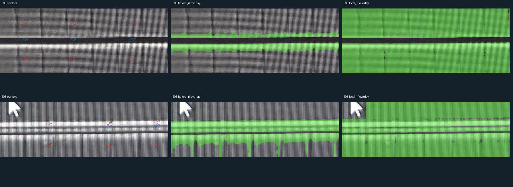
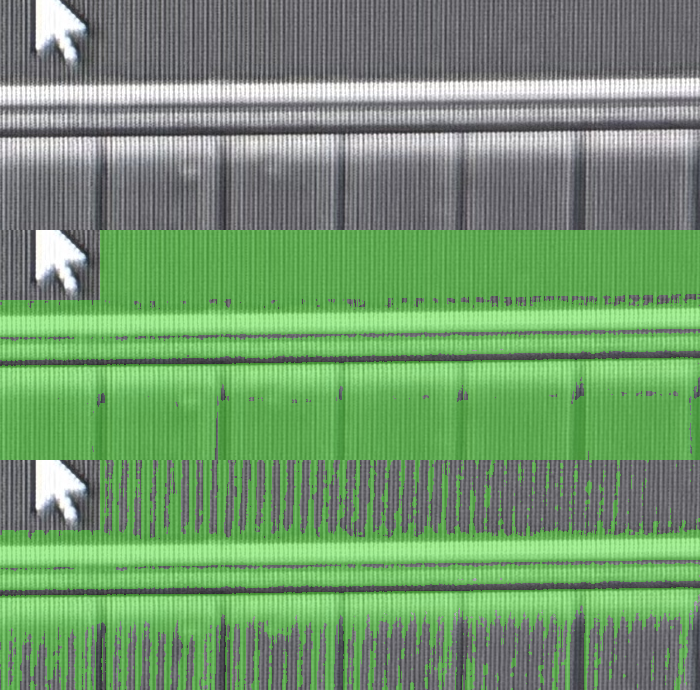

# AA 少量局部提示实验 v1

2026-10-18。[打开提示前后算法对照](../runs/aa-prompted-comparison-v1b/index.html)。

用户已确认[图中18个红蓝中心](../benchmarks/aa-algorithm-comparison-v1/human-label-review-v1.json)：S03/S05红圈中心为AA、蓝圈中心为背景。只接受中心材料身份，不扩大为整圈、取样半径、准确边界或算法输出批准。

## 本轮结果

每窗选2个AA中心、1个背景中心作为局部提示，合计6个提示；剩余12个已确认中心不用于训练，只作检查。局部随机森林在8个AA检查中心和4个背景检查中心上全部正确。暗MOS内部覆盖明显改善，两个被检查的S05间隙中心也未被填为AA。

| 方法 | AA检查中心命中（共8） | 背景中心误报（共4） |
| --- | ---: | ---: |
| 原自适应阈值 | 4 | 0 |
| 原全局训练随机森林 | 3 | 2 |
| 原固定GMM GrabCut | 4 | 2 |
| 局部提示随机森林 | 8 | 0 |
| 局部提示固定GMM GrabCut | 8 | 2 |
| 局部固定图割后再三轮细化 | 8 | 3 |

这些数字只对应**12个非训练中心**，不能称为整图100%准确。新实验增加了局部提示，不是对旧无提示检查的同预算算法升级证明。两个窗口均已被看过，属于开发/故障诊断；没有新增独立盲测成绩。



## v1b时的未决项（现已由后续裁决接续）

S05窗口上沿、大片电阻内部的一小段也被局部RF涂绿。这部分没有任何已确认检查点；12个中心全对不能决定这片区域的材料身份。当前记录为未知，**没有把它当成已确认AA或算法误报**。

[打开U的宽范围原图与精确同坐标叠加](assets/aa-prompted-comparison-v1/U-native-context.png)：左上为AA原图，右上仅在青色S05窗口内叠加候选；下方给相同窗口放大。橙色U是待判断的位置，不属于已批准红蓝中心。原生位置为AA照片(3750,3350)。

当时需裁决U的材料身份。用户现已确认电阻内部非AA，见下方后续记录；此前未知记录保留。

## 算法和信息边界

- 两方法使用相同的2个AA/1个背景中心。AA半径3、背景半径1的训练采样邻域是AI假设，未经人工逐像素批准；实际被人确认的仍只有中心。
- 局部RF使用与前轮相同15项颜色/纹理/边缘特征，100棵树、深度14，当前窗单独训练；最小叶节点1、类别平衡。原RF训练模式、叶节点及提示预算不同，本轮不是只改变单个变量的因果消融。
- GrabCut仅把已确认提示中心设为确定前景/背景；邻域颜色用于初始化GMM。第一次诊断从全可能背景开始，迭代版本塌缩到少数确定点；保留runs/aa-prompted-comparison-v1a。随后明确改为先固定GMM图割、再从该结果三轮细化，参数写入spec-v3；RF与所有标签/检查点不变，两个试验RF掩膜逐像素一致。
- 旧算法mask先校验冻结清单，再对这12个中心重新计分。没有把旧AI小块评分追溯改为人工真值评分。提示邻域与检查中心严格不重叠，改动检查标签不影响预测。
- 没有膨胀补孔、手绘环、矩形填充或正交几何拟合。所有结果仍是AA照片原生像素候选，已有全幅几何/CT/父模型均不变。

## 证据与重跑

[人工中心裁决](../benchmarks/aa-algorithm-comparison-v1/human-label-review-v1.json) · [参数spec-v3](../benchmarks/aa-prompted-comparison-v1/spec-v3.json) · [报告](../benchmarks/aa-prompted-comparison-v1/report-v1.json) · [U未知记录](../benchmarks/aa-prompted-comparison-v1/pending-U-v1.json) · [技术核查](../benchmarks/aa-prompted-comparison-v1/verification-v1.json)。

```bash
.venv/bin/python -m silicon_eye.aa_prompted_eval \
  --root . --spec benchmarks/aa-prompted-comparison-v1/spec-v3.json \
  --output runs/一个新的局部提示目录
```

317项测试通过，新增3项验证中心评分不扩张为面积、提示邻域不得与检查点重叠、检查标签不影响预测、已知合成对比边界能恢复。另核对原图/输入/模型哈希、所有mask中心分数、RF跨初始化试验一致、相关Ruff和页面JS语法。浏览器交互未自动实测；未绕过file预览限制，未提交/推送Git。

## U裁决与追加背景提示试验（v1c）

用户确认“U这里是电阻内部非AA”，已保存[原始裁决](../benchmarks/aa-prompted-comparison-v1/human-U-review-v1.json)。这确定U及其所在电阻内部的材料身份，不代表整个矩形的精确边界或电阻材料类型已确定。

[打开新对照页](../runs/aa-prompted-comparison-v1c/index.html)。仅为S05增加U背景提示：S03仍2个AA+1个背景，S05改为2个AA+2个背景。原12个检查中心不变、不参加训练。U已经用于训练，其纠正不能充当独立验证成绩。

局部RF的U由误报AA变为非AA，但原8个AA检查中心从8/8退化到7/8，新增漏检为原生(3950,3510)；4个背景检查中心仍无误报。电阻内部仍有明显绿色条纹。固定颜色GrabCut仍8/8 AA、背景误报2/4；迭代版仍误报3/4。因此本轮不放行，不能把增加一个负例后的局部纠正描述为算法已可靠。



AI选取的电阻内部诊断条带[3410,3330,4000,3395]，预测AA比例从约100%降到约32%。这是排查误报的辅助量，矩形没有人工稠密标签，不能称为准确率或IoU。既有材料身份判断、纹理造成的条纹误报与漏检应分别保留。

下一步先把电阻内部误报、暗MOS内部漏检、窄间隙隔离作为三个固定失败条件，评估局部纹理尺度和结构信息；在区域检查通过前，不推广全幅、不进入正交重建、不修改CT。不能通过手工剪掉电阻矩形或补环让指标过关。

[参数spec-v4](../benchmarks/aa-prompted-comparison-v1/spec-v4.json) · [报告v2](../benchmarks/aa-prompted-comparison-v1/report-v2.json) · [失败评估v2](../benchmarks/aa-prompted-comparison-v1/assessment-v2.json)。旧参数、旧结果和U未知记录均保留。

后续已完成[颜色/纹理/方向结构消融与综合评估](aa-texture-structure-v1.md)，保留本页作为前轮记录。
