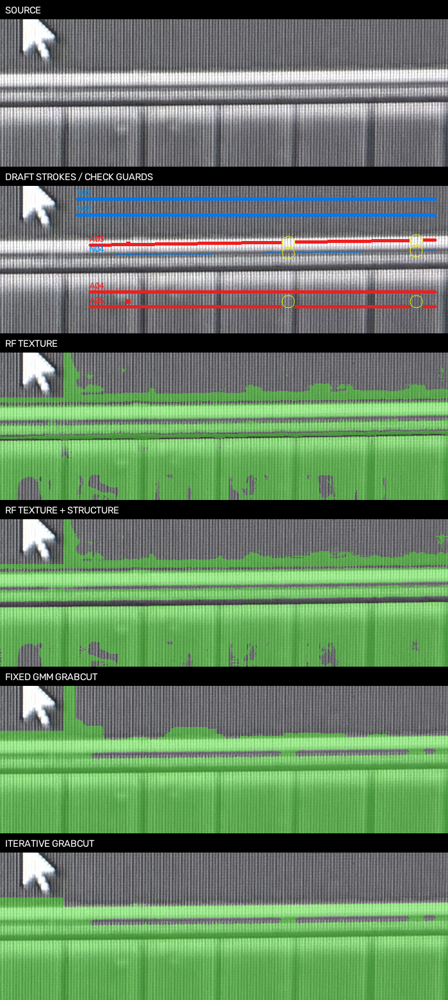
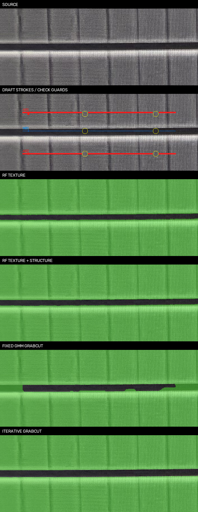

# AA区域笔画与多算法对照 v1

2026-10-18。[打开笔画样稿与算法切换页](../runs/aa-scribble-comparison-v1b/index.html)。

结论：补充覆盖明暗变化的笔画后，纹理RF和纹理＋结构RF恢复了原漏检点，三个种子都通过原8个AA、4个非AA中心检查；但电阻内部仍有残余误报，整块mask未批准。GrabCut清理电阻内部更彻底，却仍将两处已确认间隙误填为AA，不能凭画面整齐放行。

## 新样本与人工核查清单

新增9条笔画，红为AA、蓝为非AA。**全部新增整段笔画仍是AI草稿**，基于原图和既有人审材料身份选取，不追溯登记成人工已审像素。原7个训练中心保留，原12个检查中心保持不变；训练避让其周围半径10像素正方形，黄色圈仅作位置提示，实际避让为方形。各笔画宽度为1或3，OpenCV栅格化后的实际覆盖以samples.npy为准。

| ID | 窗口 | 候选材料 | 样本覆盖目的 |
| --- | --- | --- | --- |
| A01 | S03 | AA | 上侧暗MOS内部，跨明暗纹理 |
| A02 | S03 | AA | 下侧MOS内部，跨明暗纹理 |
| N01 | S03 | 非AA | 上下AA之间的窄间隙 |
| N02 | S05 | 非AA | U所在电阻内部，横跨亮暗条纹 |
| N03 | S05 | 非AA | 电阻内部第二条笔画，覆盖不同纵向纹理 |
| A03 | S05 | AA | 上侧AA横条内部，沿照片轻微倾斜 |
| A04 | S05 | AA | 下侧MOS内部较亮部分 |
| A05 | S05 | AA | 下侧MOS内部较暗部分 |
| N04 | S05 | 非AA | 两条AA之间的窄间隙 |

请核查每条笔画是否始终落在对应材料内，特别是A03较窄的AA横条和N04窄间隙。局部照片仍倾斜，笔画沿原生照片走，不对源图强制正交。不要求在这一轮确认完整边界。

样本栅格像素：S03 AA 5062、非AA 505；S05 AA 7782、非AA 6131。这些邻近像素高度相关，不等于新增19480个独立人工样本。原检查周围的图像上下文仍可能参与大尺度特征，因此本试验不是空间盲测。

## 同样样本下比较五个方案

RF分别使用颜色、颜色＋纹理、颜色＋纹理＋结构；树数100、深度14、最小叶节点1、类别平衡与上一轮一致。GrabCut用同一份栅格样本初始化颜色GMM，但额外将全部笔画固定为硬前景/背景，RF没有这些硬输出约束，因此差异包括模型机制，不能仅理解为分类器的单项能力排名。

各方案跑三个预定种子20261018/19/20，共30个窗口/算法/种子组合。参数与笔画先冻结，未按检查分数改笔画或挑选种子。

| 方案 | AA检查中心（每次共8） | 背景误报（每次共4） | 电阻内部诊断框AA占比 |
| --- | --- | --- | --- |
| RF：仅颜色 | 7–7/8 | 2–2/4 | 6.5%–7.0% |
| RF：颜色＋纹理 | 8–8/8 | 0–0/4 | 13.0%–13.2% |
| RF：纹理＋结构 | 8–8/8 | 0–0/4 | 14.9%–15.4% |
| 固定GMM GrabCut | 8–8/8 | 2–2/4 | 2.5%–2.5% |
| 迭代GrabCut | 8–8/8 | 2–2/4 | 0.0%–0.0% |

诊断框沿用电阻内部[3410,3330,4000,3395]，**本轮排除所有训练像素**，其余32724像素参与统计。矩形本身是AI选框，无稠密人工标签，以上不是准确率或IoU。不能与前轮包含新笔画位置的诊断占比直接相减；[评估JSON](../benchmarks/aa-scribble-comparison-v1/assessment-v1.json)另外提供前轮mask在本轮相同有效像素上的占比，供严格对照。

- 仅颜色RF依旧漏检AA，并把部分间隙判成AA；电阻诊断占比低并不足以证明整体更好。
- 纹理RF、纹理＋结构RF均在三个种子下命中8/8 AA、背景0/4误报。前轮持续漏掉的(3950,3510)已恢复。两窗口原12中心仍未进入训练。
- 纹理RF电阻内部残余约13%，纹理＋结构约15%。在补充笔画的条件下，增加方向特征没有继续胜出；之前特征方案的优势并非在所有训练预算下成立。
- 固定GMM GrabCut残余约2.5%，迭代版本在此诊断框为0%；但两者都把S05的2个间隙检查中心误判为AA，不能放行。0%只对应这个非训练诊断框，不代表全图正确。





## 结论与下一步

当前优先保留纹理RF作为主候选，纹理＋结构RF作参照；GrabCut保留为连续性与失效对照，不将两者mask简单并集或膨胀填补。样本覆盖改善的效果比上一轮单纯加特征更明显，但预算、候选标签数量和GrabCut硬约束都增加，不能称为纯算法升级。

下一步先由用户核查这9条笔画的材料归属，以及S05电阻内部残余误涂与AA边界。通过后再在新窗口验证迁移；不以当前中心全对封装skill或推广全幅。正式几何、CT、195保留对象及原始照片不变。

[参数](../benchmarks/aa-scribble-comparison-v1/spec-v1.json) · [报告](../benchmarks/aa-scribble-comparison-v1/report-v1.json) · [评估](../benchmarks/aa-scribble-comparison-v1/assessment-v1.json) · [核查](../benchmarks/aa-scribble-comparison-v1/verification-v1.json)。

```bash
.venv/bin/python -m silicon_eye.aa_scribble_eval --root . \
  --spec benchmarks/aa-scribble-comparison-v1/spec-v1.json \
  --output runs/新的笔画对照目录
```

322项测试通过。新增测试检查笔画保留未知状态、检查点避让、无效覆盖排除、冲突和越界拒绝；另重算所有中心分数，核对输入/代码/输出哈希、全部30张mask在仅校验/页面排版修订前后一致及页面JS语法。未自动实测浏览器交互。未提交或推送Git。

## 后续人工裁决

用户确认A01–A05始终位于AA、N01–N05始终位于非AA。[裁决记录](../benchmarks/aa-scribble-comparison-v1/human-stroke-review-v1.json)将现有九条笔画登记为沿线材料身份已审；当前样稿仅N01–N04，N05未匹配，不添加虚构位置。完整边界和算法mask仍未批准。此前报告保留试验时AI草稿状态，不追溯改写成已批准训练实验。
