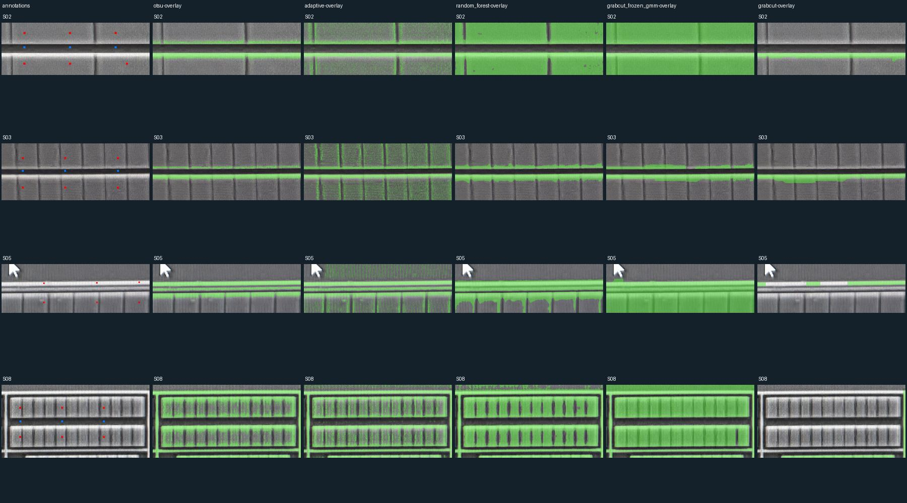
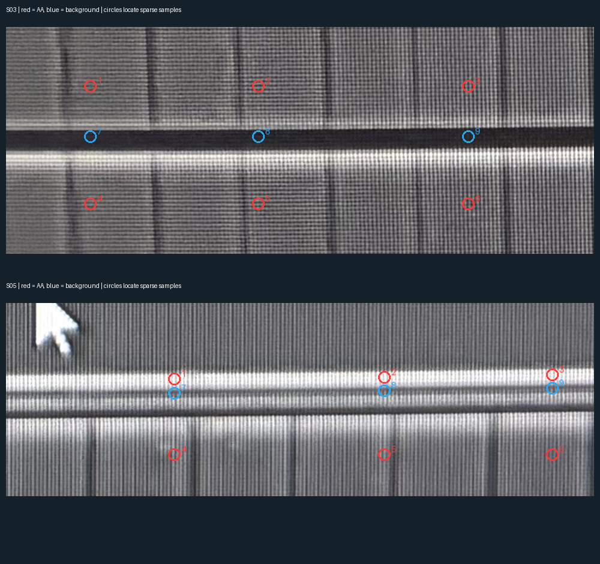

# AA 原图分割算法对照 v1

后续更新：用户已确认S03/S05图中18个红蓝中心的材料身份，取样邻域和整块mask仍未确认。原报告保持生成时的AI稀疏小块评分；[后续局部提示实验](aa-prompted-comparison-v1.md)另按非训练中心计分。

2026-10-18。[打开原图／算法切换页](../runs/aa-algorithm-comparison-v1a/index.html)。

本轮实际比较三类方法的七个固定变体：阈值四种、随机森林一种、GrabCut 两种。全部在照片原生像素上运行，不补环、不填矩形、不正交化，不修改已审 AA 模型、不处理 CT。

## 结论

**没有可以直接替换生产流程的胜出方法。**固定颜色模型 GrabCut 在本轮稀疏标记上一致性最高，但它和随机森林都误填 S05 的窄背景间隙；S03 较暗 MOS 内部仍大范围漏检。普通三轮 GrabCut 在本初始化方式下明显收缩到亮边。这些失败不能由平均分掩盖。

下一步先人工核对 S03/S05 的少量 AA/背景样本，再冻结新对照方案。随机森林与固定 GMM GrabCut 值得保留为候选；尚不能证明随机森林优于 GrabCut，也不能只凭最高分推广固定 GMM。

| 方法 | 4个空间检查窗平均稀疏平衡一致率 | AA 标记检出 | 背景标记误报 |
| --- | ---: | ---: | ---: |
| GrabCut 固定颜色模型 | 75.0% | 75.0% | 25.0% |
| 随机森林 | 70.5% | 65.9% | 25.0% |
| 自适应阈值 | 69.5% | 39.1% | 0.1% |
| 光照校正＋Otsu | 59.3% | 18.5% | 0.0% |
| Otsu | 58.7% | 17.4% | 0.0% |
| 固定阈值156 | 56.2% | 12.5% | 0.0% |
| GrabCut 三轮细化 | 54.2% | 8.3% | 0.0% |

表中数值只对应 AI 拟定的少量标记，**不是人工真值准确率、整图召回率或稠密 IoU**。每窗先计算前景/背景指标，再对四窗等权平均。检查窗样本不进入训练；但窗口都来自已开发的同一颗芯片，且本轮结果已被查看，不能再当未见过的调参验证集。后续调参须另留新检查样本或明确作为开发回归。



## 方法与公平边界

- 阈值组：固定156、Otsu、局部自适应、扣除缓变光照背景后的 Otsu。固定156仅是旧阈值的对照，不是带旧矩形补全的整条旧流水线。共同平滑参数在跑图前冻结，未根据结果寻找最优阈值。
- 随机森林：Lab颜色、四尺度局部平均、标准差和边缘强度，共15项特征；100棵树、固定随机种子、两CPU线程。用四个训练窗口的正负样本拟合，只对另四窗作空间保留检查；未使用版图参数或器件框来补输出。
- GrabCut：与随机森林使用同一批训练颜色样本，先初始化前景/背景 GMM。分别测试固定颜色模型的一轮图割、允许颜色模型更新的三轮细化。检查窗不给任何确定前景/背景标签，初始化为 Otsu 的可能前景/背景；训练窗仍使用确定提示，但训练窗分数不进入排名。这是“训练提示向无提示窗口迁移”的具体协议，不代表每窗有交互提示时 GrabCut 的上限。
- 所有二值 mask 都是模型候选；零值不是人确认不存在 AA。没有进行膨胀、闭运算、组件合并或规则几何补全。已知光标遮挡使用同一排除框，未将截图光标当 AA 进行评分。

OpenCV当前5.0构建不含ml模块，实验增加可选依赖 `segmentation-eval`，不改变常规运行依赖。首次下载中断包因SHA256不符被拒绝；重试仅从官方PyPI获取轮子，逐包对照PyPI元数据校验SHA256后安装。未放宽校验或上传照片。安装版本与算法耗时见报告；阈值耗时是四个变体合计，不应当作每个方法单独的速度基准。

算法参考：[OpenCV 阈值](https://docs.opencv.org/4.13.0/d7/d4d/tutorial_py_thresholding.html)、[OpenCV GrabCut](https://docs.opencv.org/3.0-last-rst/doc/py_tutorials/py_imgproc/py_grabcut/py_grabcut.html)、[局部特征与随机森林像素分类示例](https://scikit-image.org/docs/0.25.x/auto_examples/segmentation/plot_trainable_segmentation.html)。本项目用OpenCV计算特征，未安装scikit-image。

## 样本、标签和局限

8个原生窗口：S01相邻长条、S02/S03两组大MOS间隙、S04折线小AA、S05电阻与MOS环间距、S06 dummy、S07大MOS、S08底部器件组。

训练为 S01/S04/S06/S07；检查为 S02/S03/S05/S08。标签为AI根据原图拟定的稀疏小块，未标像素都是未知，不把背景补成“全图负样本”。原有人类结构反馈只用于选择值得检查的类型，不被转换成完整像素真值。

正式运行之前进行过原图标签质检：纠正窄间隙标记和误落在亮边的点，移除一个误落在分隔AA墙上的负例；保留[质检记录](../benchmarks/aa-algorithm-comparison-v1/label-audit-v1.json)。这些修改发生于任何算法输出之前；出图之后没有根据得分改标签或调参数。最终参数为spec-v4，前几版保留方案冻结过程。

小样本统计还提示，在这些AI训练点中AA与背景灰度范围重叠，RGB通道最大差的中位数都约为6；不能把“局部看得出差别”直接解释成“全图一个颜色阈值足够”。这只是样本诊断，不是已确认的物理材料颜色分布。

目前最需要你确认的是下面两个场景：**只看红圈中心是否确实是AA、蓝圈中心是否确实是背景，无需判断算法。**圆圈只是定位，实际取样小块由参数记录。



## 固定工作顺序

[照片分割与几何重建合同 v7](architecture/aa-segmentation-contract-v7.md)：原照片与有效区 → 明确前景/背景样本及未知 → 照片分割 → 材料/背景/间隙验收 → 保持拓扑的正交几何重建 → 重建前后再检查 → 矢量与像素输出。PDK和版图先验不得凭空补环或改连接。

## 重跑和验证

```bash
.venv/bin/python -m pip install -e '.[segmentation-eval]'
.venv/bin/python -m silicon_eye.aa_segmentation_eval \
  --root . --spec benchmarks/aa-algorithm-comparison-v1/spec-v4.json \
  --output runs/一个新的算法对照目录
```

[冻结输入](../benchmarks/aa-algorithm-comparison-v1/spec-v4.json) · [报告](../benchmarks/aa-algorithm-comparison-v1/report-v1.json) · [评估结论](../benchmarks/aa-algorithm-comparison-v1/assessment-v1.json) · [技术核查](../benchmarks/aa-algorithm-comparison-v1/verification-v1.json)。

314项测试通过（新增4项），覆盖未标记像素保持未知、冲突标签拒绝、检查区标签/像素不进入训练数据、稀疏指标不把未知背景计为正确、原生尺寸与间隙保留。另核验148项输出哈希、重算所有已保存mask的稀疏指标、代码/参数/照片/既有重建快照不变、相关Ruff、pip check、页面JS语法。浏览器交互未自动实测，未绕过已有file预览限制；未提交/推送Git。
