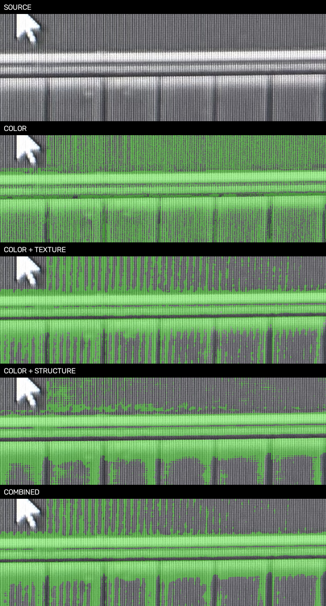
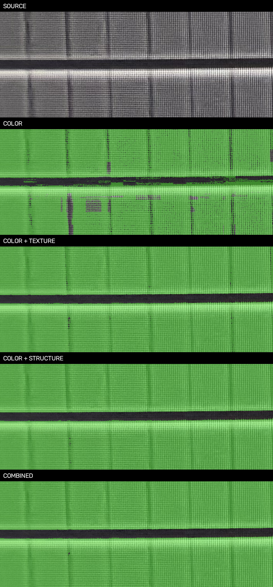

# AA 纹理与方向结构验证 v1

2026-10-18。[打开四组特征、三种子的对照页](../runs/aa-texture-structure-v1b/index.html)。

结论：方向结构能减少电阻内部误报，原纹理也比只用颜色有效；但四组特征都保留已确认AA点的漏检，均不能放行到全幅或正交重建。当前证据支持继续研究结构信息，不支持宣称已找到可靠提取算法。

## 固定条件与本轮实际验证内容

沿用[U确认后的spec-v4](../benchmarks/aa-prompted-comparison-v1/spec-v4.json)及19个人工中心：7个训练、12个仅检查，U用于训练。S03为暗MOS与窄间隙，S05为电阻、环和MOS。所有方法使用同样提示、标签、100棵树、深度14、最小叶节点1、类别平衡、sqrt随机特征采样、同样的排除区域。先冻结参数，再运行三种子20261018/19/20，未按成绩选种子或调整标签。

| 组别 | 实际输入 | 特征数 |
| --- | --- | ---: |
| 仅颜色 | Lab三个通道 | 3 |
| 原纹理 | Lab + 1/2/4/8像素尺度的均值、标准差、梯度幅值 | 15 |
| 方向结构 | Lab + 两尺度梯度结构张量能量、方向一致性/轴偏好 + 15/31/63像素长条邻域的横纵均值与差 | 20 |
| 纹理与结构合用 | 原纹理 + 上述方向统计 | 32 |

这里的“结构”是照片的方向、边缘分布与邻域统计，**尚不包含器件语义、环拓扑、周期阵列建模**。横竖长条仅测量照片证据，不将输出拉直，不填孔、补环或推断连接。sqrt在不同维度实际抽取的特征数不同，因此本轮比较的是各特征方案的实测效果，不能宣称只增加某个单一描述量就具有独立因果收益。

结构张量使用梯度二阶矩的方向信息，可回查[OpenCV官方文档](https://docs.opencv.org/4.5.2/d9/dbc/tutorial_generic_corner_detector.html)。随机森林设置见[scikit-learn官方文档](https://scikit-learn.org/stable/modules/generated/sklearn.ensemble.RandomForestClassifier.html)。本轮用整组特征消融，不用树内重要性排名解释因果；[官方示例](https://scikit-learn.org/stable/auto_examples/ensemble/plot_forest_importances.html)提示此类重要性存在偏差。

## 结果与失败条件

下表范围包含全部三个种子，AA/背景分母是每次同一批8/4个检查中心，不能把三次重复运行当作36个独立样本。

| 特征方案 | AA中心命中 | 背景中心误报 | 电阻诊断条带预测AA比例 | 平均比例 |
| --- | --- | --- | --- | --- |
| 仅颜色 | 7–7/8 | 0–1/4 | 59.5%–66.3% | 62.8% |
| 颜色＋原纹理 | 7–7/8 | 0–0/4 | 26.7%–31.9% | 28.5% |
| 颜色＋方向结构 | 7–7/8 | 0–0/4 | 13.9%–28.5% | 19.7% |
| 颜色＋纹理＋方向结构 | 7–7/8 | 0–0/4 | 19.3%–23.9% | 22.3% |

电阻条带是AI选择的[3410,3330,4000,3395]，位于用户确认的非AA电阻内部；具体矩形没有稠密人工标签，比例只能作误涂诊断，不能替代IoU、精确误报率或整图准确率。

- S03三个种子、四组特征都命中4/4 AA、背景0/2误报；视觉上暗AA覆盖与中间间隙基本可用，但仍非边界精度验收。
- S05四组都只有3/4 AA检查点正确，原生(3950,3510)持续漏检。增加特征没有解决这个已知问题。仅颜色在一个种子还误报了1个窄间隙中心。
- 方向结构将电阻条带平均误涂从仅颜色约63%降到约20%；但种子范围约14%–29%，并不稳定，且仍有残余条纹。两者合用平均约22%，三个种子约19%–24%；其稳定性较好，但没有在本指标上超过单用结构的平均表现。
- 原纹理方案种子20261018与上一轮局部RF mask逐像素一致，说明本轮基线可复现；没有把实施变更或提示变化当成特征收益。
- 三个种子分歧图仅显示模型敏感性，所有种子一致也可能一起判断错误。





## 与前几轮算法综合对照

| 算法 | 在这批照片上的优点 | 已发现的主要失败 | 现阶段用途 |
| --- | --- | --- | --- |
| 固定阈值 / Otsu | 无需训练、便宜、容易复现 | 受亮度与屏幕纹理影响，常只留下亮边，暗AA内部漏检 | 保留简单基线及候选证据 |
| 局部自适应阈值 | 比固定阈值更适应缓慢亮度变化；旧12点检查AA4/8、背景误报0/4 | 局部对比不代表材料，内部容易空，产生条纹 | 亮边/局部结构辅助，不作最终AA |
| 光照校正＋Otsu | 能处理部分低频光照变化 | 旧实验仍大量漏掉暗AA内部；光照校正不能恢复材料语义 | 预处理候选，不能单独放行 |
| 全局小样本RF | 可融合颜色和纹理，不限于一种阈值 | 跨区域迁移失败：旧12点AA3/8、背景误报2/4 | 待更有代表性的训练样本后再验证 |
| 局部RF | 暗AA覆盖改善，能显式引入非AA负例；可做特征消融 | 少量提示代表性不足，U负例会引发AA漏检；方向统计只能部分缓解 | 当前最值得继续验证的主候选，尚未批准 |
| 固定GMM GrabCut | 用颜色概率与相邻像素平滑得到连续区域；局部提示后AA8/8 | U确认后的同提示预算仍背景误报2/4，窄间隙易被跨越 | 连续性参照，不直接替代材料判断 |
| 迭代GrabCut | 允许模型随区域更新 | 对初始化敏感；曾塌缩，修正初始化后仍背景误报3/4 | 暂不作为主方案 |

阈值、全局RF和局部RF的训练信息预算不同。旧无提示实验的面积分数基于AI草拟小块，不与本轮人工中心分数混为同一排行榜。以上比较支持用途取舍，不给出“全图最好”的结论。

## 下一步与质量门

下一步采用**少量有代表性的区域笔画标注**，覆盖电阻条纹的明暗部分、MOS内部的明暗部分、环和窄间隙；先由AI出标注样稿，人只确认材料身份，保留未知边界。单个背景中心附近9个训练像素无法代表完整电阻纹理；同一提示附近高度相关的像素也不等于大量独立样本。

保留现有12个检查中心不参与训练，同时逐区域检查AA内部覆盖、电阻内部误报、环/间隙是否被误连。任何已确认AA中心漏检或已确认非AA间隙误连都拒绝放行；中心全对仍须审查完整区域。后续需新窗口验证迁移，现有两个窗口只算开发回归。暂不引入形态学填充或按矩形裁剪来掩盖错误。

## 证据与重跑

[冻结参数](../benchmarks/aa-texture-structure-v1/spec-v1.json) · [结果](../benchmarks/aa-texture-structure-v1/report-v1.json) · [汇总评估](../benchmarks/aa-texture-structure-v1/assessment-v1.json) · [技术核查](../benchmarks/aa-texture-structure-v1/verification-v1.json)。

```bash
.venv/bin/python -m silicon_eye.aa_texture_eval --root . \
  --spec benchmarks/aa-texture-structure-v1/spec-v1.json \
  --output runs/新的纹理结构对照目录
```

首次运行v1a保留；仅修正页面代码排版后重跑v1b，所有mask逐像素一致。软件测试检查均匀区域不制造方向证据，以及转置后方向交换、能量不变；真实材料有效性仍以以上失败结果和人工复核为准。未进行浏览器交互自动实测；无Git提交/推送，无CT或正式几何修改。

后续已完成[区域笔画样稿与五算法对照](aa-scribble-comparison-v1.md)，本轮保持为历史参照。
