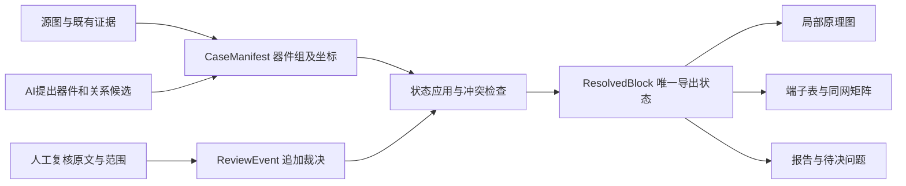

# 局部器件组复核：最小架构设计 v1

2026-10-16设计；同日B/C最小实现已接入`annotate block`，见[使用与实现边界](../block-review.md)。旧工具保持原行为。

目标：同一案例使用同一份有效裁决状态生成原理图、端子表和同网矩阵；换ROI主要换数据，不继续向绘图/裁决函数添加案例名。
范围限于局部结构复核。自动识别平台、调度系统、数据库、模型服务、PDK、仿真和整芯片重建均不在本轮。

## 1. 处理链与职责

AI负责多层理解、候选及判别动作，脚本负责坐标/计算、引用校验、状态应用和导出；人工负责关键物理判断。
会话AI可继续提供候选，不要求先接入运行时视觉API。原始照片、历史候选与人工原记录保持不变。

本设计只增加一个局部复核数据边界，不直接改写微米制DeviceList/CleanNetlist，也不在缺数据时强行转入仿真模型。

## 2. 数据契约

[可检查的V3实例](block-case-v1.example.json)保留为设计样例，不直接传给CLI；运行参数见[规范化V3案例](../../benchmarks/block-case-v1-v3.json)。实现采用Pydantic检查及显式状态应用，当前仅覆盖下述受限v1范围。
本节规定v1必需语义；引用类型、状态应用和输出一致性的实现验收见后文。

### CaseManifest：显式案例清单

| 字段 | 约定 |
| --- | --- |
| schema_version / case_id / revision | 契约版本、稳定案例ID、案例修订；不能由运行目录名猜测 |
| sources | ID→仓库根相对路径与SHA-256；禁止凭证、临时签名URL；缺失或漂移明确失败 |
| frames | 来源ID、原生尺寸、px单位和xy半开坐标；每张照片独立坐标系 |
| scopes | 关系的适用域：器件组电气关系、物理身份、某层某区域；局部否定不升级全局隔离 |
| entities | 稳定ID及类型：device、terminal、device_group、physical_region、conductor_inspection_feature、image_feature |
| geometry_observations | 实体、frame_id、xywh/折线、producer和状态；检查窗口不等于材料边界 |
| measurements | 对象、量、单位、测量方法/来源与截断限制；px代理与真实W/L分开，缺尺度不换算 |
| claims | 尚待或已经复核的命题；必须有predicate、subject_ids、scope_id、value、intent、producer、evidence_refs |
| review_events | 追加且不覆写的单命题裁决，引用原复核来源；不能只把actor=human当成物理证据 |
| review_inventory | 本修订声明的复核文件与事件清单；不是目录扫描结果 |
| export_request | current或显式snapshot；当前模式不得悄悄重放旧候选参数 |

每个MOS固定列G/A/B/Bulk四个稳定端子ID，A/B不指定源漏；未知值用null，不把所有unknown体端聚成一个节点。
器件组明确列member_ids；物理区域可列terminal_ids用于说明归属，不凭这些归属隐式并网。

几何必须引用frame；若采用变换，需要源/目标frame、矩阵方向、拟合与独立检查来源及acceptance。
相同图像尺寸、同屏位置或结构身份确认不能代替变换。没有变换可以并列看图，不能伪装精确叠加。

外部端口必须附真实可定位的出界截面/端子证据；逻辑端子标号不是已验收的物理端口。

### Claim：关系必须分型

| predicate | subject_ids与value | 接受后的作用 |
| --- | --- | --- |
| device_exists | 一个device，true/false | 器件存在性；不自动赋予类型/尺寸/连接 |
| shared_physical_region | 两个或以上terminal及一个physical_region，true | 物理共享事实；电气同网仍需明确关系记录 |
| joined_in_region | 两个physical_region，boolean，scope必须含层/区域 | 该区域的物理连接/断开；不修改其他层电气同网 |
| same_feature_identity | image_feature与device_group等，true | 结构身份对应；不生成变换或电气连线 |
| terminal_maps_to_conductor | 一个terminal与一个导体检查对象，true | 接触组到局部金属的关联；不据同名特征自动合并其他端子 |
| same_net | 两个以上terminal，true，电气scope | 只有明确确认后才参与同网闭包 |
| different_net | 两个terminal，true，明确电气scope | 显式隔离约束；局部间隙不能当作此命题 |

未声明的关系默认为未知；候选命题不进入确认同网图。端子与导体关联若支持新的同网推断，必须产生有证据的same_net候选再复核，不能藏在导出器内部。
检查对象的几何边界仍可能是候选，即使其身份/端子关联已获确认；对象不能只有一个总状态代替这些不同判断。

网络名N3_GM等是展示标签，不是物理对象主键。确认图先按稳定端子ID及有效same_net形成连通分量，再附展示名与别名。
单独端点的不同分量只表示尚未证明相连，不是确认彼此隔离。

首版实现边界：一个器件组只允许一个电气scope；几何为候选检查窗，像素支持代理每器件一份；MOS类型/源漏/位置未知，拒绝未支持的真实尺寸或极性输入，尚不导出物理边界端口。

### ReviewEvent：单命题、显式替代

必需字段：id、claim_id、verdict、actor、source_refs、source_statement、supersedes_event_ids。
actor区分human/script/vision_model/reasoning_model。source_statement是源记录摘录；脚本整理出的unknown不能伪称用户明确要求defer，也不能提供物理confirm。
一条用户回复可标准化为多条事件，但都绑定相同原文与哈希，不冒充多次独立人工验证。

| verdict | 当前命题的结果 | 不能推导 |
| --- | --- | --- |
| confirm | 采用命题明确给出的值，保留范围与来源 | 不扩大到整个对象、其他层或所有端子 |
| reject | 命题被拒，保留反对来源 | 不自动产生逆命题；“拒绝连接候选”不一定等于“确认隔离” |
| no_evidence | 无证据，结果unknown | 不能生成different_net，也不能撤销其他已确认关系 |
| defer | 延后/无法判断，结果unknown | 不可从“没回复”推定批准 |
| withdraw | 明确撤回所指旧决定，恢复为待决/未知 | 不生成任何反向物理事实 |

样例的局部poly不连是根据用户明确否定原文标准化为joined_in_region=false；不是把一个泛化的reject机械翻译成隔离。
首次阶段，真实物理/电气确认只消费已绑定的人工记录；脚本确认的是引用、计算及逻辑一致性，不能自行升级照片判断。

## 3. 如何确定“最新有效”

1. 案例清单是唯一登记入口，新反馈必须与inventory更新一起落入一个修订。文件系统里出现一个未登记JSON，不会自动被视为已应用。
2. 校验来源哈希、ID唯一性、引用、范围、命题/事件类型及必需端子。缺数据直接失败，不静默回退到旧结果。
3. 对每个claim按显式supersedes关系形成无环历史；只能替代同一claim的事件。先前defer可被confirm明确替代。
4. 不按文件顺序、mtime或聊天日期“最后一条获胜”。两个未互相替代的并行决定，若作用不一致，记conflict；若重复同义，保留所有来源。
5. 用当前有效决定从头计算状态，不在旧网表上累积修改。撤回同网后可能拆分，因此不能只做不可逆union。
6. 检查same_net的传递闭包与明确different_net约束是否冲突；物理层/区域否定必须先按scope分型，不能与其他层的电气同网误判矛盾。
7. 得到ResolvedBlock后，所有导出器只读这一对象，不再读取反馈目录或私自补线/着色。

完整性边界：系统不能从少量已列文件猜到有人在其他目录保存了新复核。
因此“最新”仅指权威CaseManifest登记的当前修订。迁移时必须把既有反馈清单核对完整，之后写入反馈时强制登记。
历史snapshot允许指定旧修订及哈希，但输出必须清晰标明历史，不能标成current。

## 4. 唯一导出状态与输出门槛

ResolvedBlock至少包含：case_revision、input/inventory摘要、有效事件与被替代事件、逐命题状态、器件/端子、确认同网分量、候选关联、未知关系、局部否定约束、边界端口、验收级别。
派生状态枚举为candidate / confirmed / rejected / unknown / conflict，补充原因；no_evidence是unknown的原因，不是一个断开状态。

state_id根据规范化输入内容与有效决定摘要计算；软件版本/参数摘要另记。不同案例名不决定语义，重排等价输入不改变结果。
图、端子表、矩阵及报告均携带相同state_id；图色由逐关系状态决定，不再按N3_GM等固定名字决定。

- 确认同网矩阵：端子自身self、明确同网K、明确同范围隔离D、其余?。Bulk1/Bulk2未知时仍是两个端点。
- 结构稿：允许unknown，但需显著标注；conflict必须展示冲突来源，不导出为已验收网表。
- 局部拓扑：关键块内关系和可定位边界满足相应复核门槛，才能声明通过；不能把未解内部问题藏到边界外。
- 电气/仿真：类型、体端、源漏约定、物理尺寸和模型具备用途所需依据前，保持不就绪。

render不执行任何状态判定；验收级别也是ResolvedBlock的结果，不由“PNG生成成功”决定。

## 5. 现有模块映射与保留边界

| 当前位置 | 已有能力/缺口 | 最小迁移 |
| --- | --- | --- |
| [schemas/pixel_annotation.py](../../silicon_eye/schemas/pixel_annotation.py) | 有像素/来源/状态验证，但角色限标注控制点/区域，尚无器件/裁决历史 | 复用约定，不硬扩旧角色承担全部器件组状态 |
| [schemas/devices.py](../../silicon_eye/schemas/devices.py) | DeviceList要求微米bbox/面积，Terminal也要求微米位置 | 保留；局部像素案例不强转为ExtractedDevice |
| [network_reviews.py](../../silicon_eye/network_reviews.py) | 能消费部分反馈，显式替代/未知保护；决策ID和V3物理端子写在分支中 | 提取通用事件应用语义；旧ID经显式数据映射成类型化claim/event，不把V3/P2名写入通用引擎 |
| [device_network_review.py](../../silicon_eye/device_network_review.py) | 校验来源、计算、导图；基于每个spec列出的反馈；读不全最新反馈会重放旧解释 | 逐步分离候选生成/几何量测与裁决/导出；单案例统一清单先接入 |
| [upper_routing_review.py](../../silicon_eye/upper_routing_review.py) | P2身份已有独立处理，诊断不并网；身份ID/器件组和层次图仍固定 | 身份变成claim类型；诊断成为来源，不加入电气fold；不扩上层追线 |
| [local_schematic.py](../../silicon_eye/local_schematic.py) | 已有Canvas和通用MOS图；网络颜色/底部语句按V3特设 | 复用Canvas；颜色、节点名、未知提示从ResolvedBlock读取 |
| [pipeline.py](../../silicon_eye/pipeline.py)及CleanNetlist | 自动提取仍明确未实现；后续清理/仿真是另一接口 | 本轮不接成自动流水线、不触发清理/删除或补造SPICE |
| [V3快照](../checkpoints/2026-10-16-v3-reviewed.json)及分散反馈 | 有完整可读结论，但本机组装稿与旧入口不统一 | 首先作为适配/重放的语义对照；不追改历史反馈 |

## 6. 最小迁移次序与停止点

| 步骤 | 交付 | 验收与停止 |
| --- | --- | --- |
| A，本轮设计 | 本文、V3契约实例、现有模块映射、验收案例 | 静态引用和来源核验；明确当前工具尚不消费新契约。设计阶段的停止点 |
| B，首个最小实现 | 局部数据模型/检查 + 通用事件状态应用 + 基于数据映射表导入既有V3记录（无V3专用脚本） | 使用现有V3语义回归，不增加识别算法或专用P2分支 |
| C，统一导出 | 一个状态驱动图/表/矩阵；当前反馈登记并消费 | 改一个人工决定时，各输出一致更新；no_evidence仍不并网/隔离 |
| D，第二ROI复用 | 选择未参与V3调参的小区域，仅换案例数据和候选 | 不向通用状态/绘图加新ROI名字；独立报告人工修正和未知，不能宣称跨芯片泛化 |

B/C可以在一个小实现任务中完成；D是检验架构是否值得继续的门槛，不先建设完整框架。
若V3旧记录无法无损表达，应先指出契约缺口再修订，不把丢失语义归咎于旧记录。
V1/V2参与过先前开发，不能当独立盲测；它们仍可做普通回归。

## 7. 行为验收（B/C受限实现已有回归覆盖，第二ROI尚未验证）

| 输入/操作 | 预期 |
| --- | --- |
| 应用V3规范化样例 | 两MOS；Q1.G/Q1.B/Q2.G/Q2.A四端同网；A/B局部M1映射确认；两Bulk各自未知 |
| P2身份confirm | 只增加身份事实，不生成变换或同网边 |
| 局部poly不连 + 两栅经金属同网 | 不冲突，不拆电气网络 |
| A/GM、B/GM、A/B均no_evidence | 全部保持?，既不并网也不标D |
| 新决定未显式替代旧的相反决定 | conflict，禁止已验收导出 |
| 替代defer为confirm，或明确撤回same_net | 按历史重算；该拆分时能拆，不留旧union残留 |
| 同网传递闭包与同范围different_net冲突 | 明确报告冲突；不能只检查直接边 |
| 交换事件数组顺序/重复运行 | 相同语义状态、逐输出state_id一致 |
| 删除必需端子、改动绑定来源、跨claim替代或替代成环 | 明确失败，不能继续导出成功状态 |
| 缺失新反馈登记 | 不能宣称已消费目录中任意最新文件；由当前manifest/inventory完整性流程拒绝该写入/修订 |
| 只换新ROI数据，未知Bulk都为null | 不添加案例分支，未知Bulk仍不合并；无尺度不转换微米 |

B/C已实现局部模型、状态应用和同状态输出，15项新行为回归覆盖主要边界；全套179项测试通过。不能由此宣称第二ROI、运行时识别、完整局部电气验收或仿真完成。
