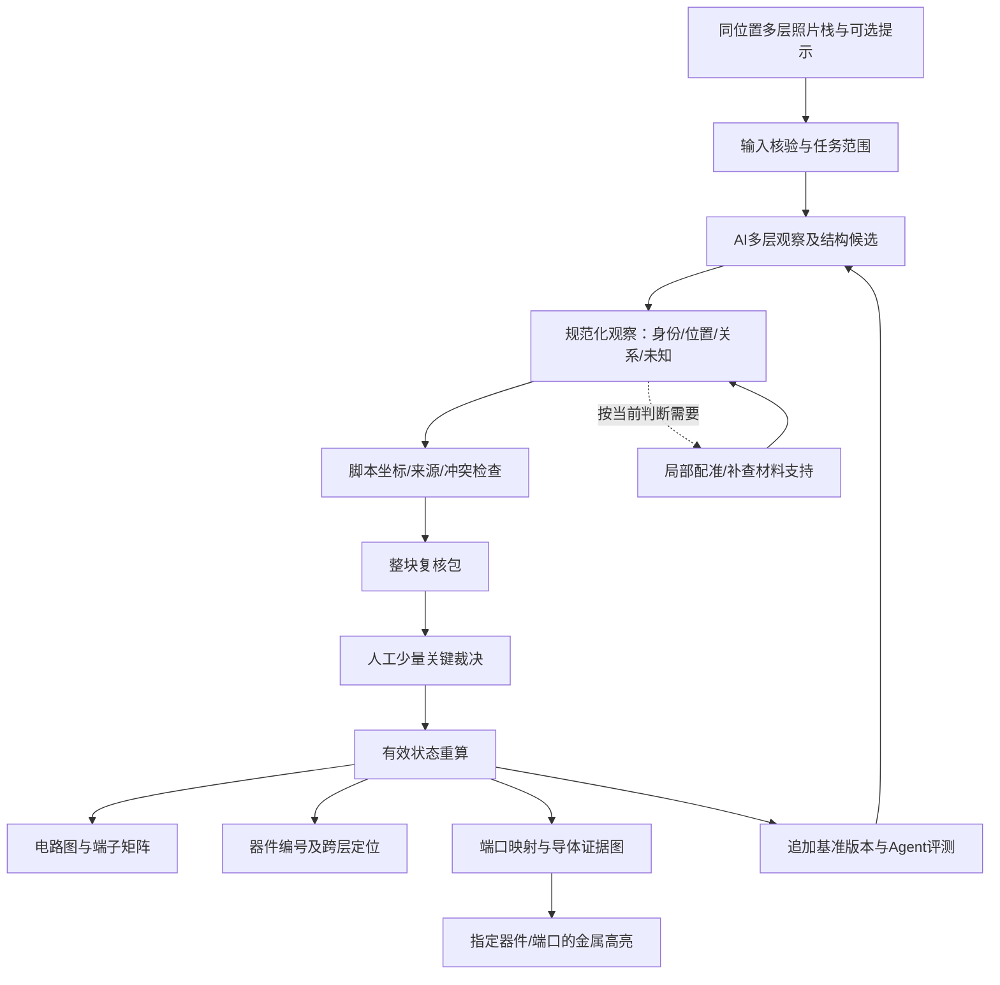

# 从同位置多层照片到多种输出：顶层工作流 v1

2026-10-16。依据用户本轮要求、README的三阶段目标及[局部纠偏](../workflow-realignment-2026-10-16.md)制定。本文是接口与实施顺序设计，不表示器件自动提取、金属追踪、交互点亮或skill已经实现。

## 产品输入与输出

正式输入是**同一芯片、同一物理区域的多层照片**，例如AA/poly/M1/M2；每张保留独立原生坐标、层名来源及拍摄信息。允许手持拍屏畸变。相同尺寸/文件名/截图位置不能自动证明同一位置，也不要求所有照片先全图精确对齐才能开始局部分析。

配准记录、先前标注和人工提示是可选的既有证据，不是首次任务必须预先准备好的完整答案。未来正式`PhotoStackManifest`负责scene_id、chip_id、layer images、frame_id、物理区域对应与尺度来源；本轮`local_photo_task`只实现局部评测所需的最小子集，不能冒充整个照片栈接口已经完成。

| 输出 | 依赖什么 | 可以先交付什么 |
| --- | --- | --- |
| 局部电路图/端子表/连接矩阵 | 器件及逻辑关系 | 带未知的MOS结构图；不必等到可仿真 |
| 每个器件的编号及照片位置 | 稳定器件ID、图像对象和对应关系 | 候选/已确认分开显示，跨层用同一器件ID |
| 器件四端与金属端口 | terminal_id→端口锚点→导体对象的有来源映射 | 可先由人指定，不要求先自动追整网 |
| 指定器件/端口后的金属高亮 | 导体几何、接触/via映射、确认连接图及变换 | 先高亮已知段，未知处停止，候选段另色 |
| SPICE/仿真输入 | 类型、尺寸、四端、模型与用途验收 | 条件不足就不输出“仿真就绪”结果 |

各输出是同一状态的视图，可分阶段具备，不组成“只有整条流水线全通过才能看任何输出”的单一路径。

## 顶层流程

局部配准、CT识别和边界提取是按需调用的子任务，不是产品本身。当前`review-package`处在“整块复核包/视图重放”位置，不承担整个AI判断或顶层任务编排。

## 共同数据主干

需要区分以下对象；首轮可采用有版本JSON，无需先建数据库或通用调度器。

| 对象 | 应记录的关键内容 | 不得混淆 |
| --- | --- | --- |
| PhotoStack / Frame | 原图、层名、native坐标、尺度证据、区域身份 | 原图像素与统一显示坐标 |
| ImageFeature / MaterialObservation | 材料身份候选、内部支持、边缘/遮挡未知、来源 | 认对poly与精确掩膜通过 |
| Device / Finger / Group | 稳定ID、物理指与器件分组关系、定位证据 | 两条栅指与两个完整独立MOS |
| Terminal | G/A/B/Bulk或其他器件端子，归属器件 | 未定A/B与已指定源漏 |
| PortAnchor | 人工/AI指定的金属端口，layer/frame/点或区域、来源与状态 | 逻辑端子与已定位金属端口 |
| Conductor / Contact / Via | 原生几何及类型、候选或确认连接边 | 亮点、几何接近与真实电气连接 |
| ReviewEvent / ResolvedState | 裁决原文、适用范围、替代关系、当前有效状态 | 历史反馈与当前仍生效的批准 |
| Export / Evaluation | 同一状态的视图、可追溯版本、部分参考答案 | 软件重放与AI任务正确率 |

旧`DeviceList`依赖bbox_um、area_um2等字段，不能直接用未校准照片填入假微米值来迁就旧格式。观察/定位层先保留frame_id+native px；物理尺度及校准来源独立，后续以明确适配连接旧网表接口。

器件ID不能按每次绘图遍历顺序重编。跨层ImageFeature通过有证据的`represents`关系映射到同一个器件ID。分裂/合并应保留原ID、别名/继承和修订，不把历史人审记录移接到新的物理对象。现有C001等同网标签只是展示名，不作为永久网络主键。

## 金属端口与点亮的演进路径

1. **先有稳定编号**：选器件ID，展示其多层原图窗口和四端当前状态。
2. **允许人工指定端口**：指定器件、端子角色、金属层、原生点/区域，追加映射事件。缺尺度不影响原生像素标注；M1宏观配准不够精确时直接在M1原图指定。
3. **先做限定高亮**：返回该端口明确映射的导体段，不因逻辑same_net就猜出全网像素形状。
4. **逐步加入追踪**：AI提出断裂/残留/过孔解释，脚本在确认导体图上求可达分量；未确认边停止传播。跨层高亮需要有来源的contact/via关系。
5. **保留查询状态**：请求至少含device_id、terminal_role、目标层/视图、decision_revision。响应列出已知导体段、候选段、未知停止点与原图证据；无法映射时明确返回未定位，而不是空图冒充不存在。

只有确认边可产生“已确认”高亮；候选可用不同样式显示，但不能参与确认闭包。高亮是物理导体图的查询视图，电路图是逻辑关系视图，两者通过端口锚点关联，不能互相替代。

## 三类门槛

- 软件门：来源/坐标/变换/状态与导出按设计运行，错误显式失败。
- Agent任务门：对固定照片任务比较材料/器件/关系候选、无证据断言、漏掉已知事实和人工干预；没有参考的部分不判错也不当正确。
- 物理用途门：分别批准材料身份、粗位置、配准用途、精确边界、端口映射、连通及尺寸。没有一个总PASS能替代这些不同批准。

## 当前实现与后续最小顺序

| 环节 | 当前状态 |
| --- | --- |
| 来源哈希/原生坐标、局部配准执行工具 | 已有；ROI2仅宏观用途获确认 |
| 电气裁决/冲突/未知、统一图表 | 已有受限实现 |
| 配准/材料/电路联合复核包 | 已有，可用版本化归档在新检出重放 |
| 最小AI观察格式与两个历史评测种子集 | 本轮实现schema和断言比对工具；没有新模型成绩 |
| 新观察适配到case/材料卡 | 已有最小显式适配与统一包展示；仅已有实体/明确范围，候选不改人审 |
| 正式照片栈任务入口 | 本文规范方向，尚未实现 |
| 器件跨层编号视图 | [已实现可选统一包输出](../device-index-v1.md)：既有ID、原生窗口/宏观投影、明确未定位 |
| 端子局部金属高亮 | [候选锚点/单段demo已实现](../terminal-highlight-demo-v1.md)，等待物理对应复核；不写入已确认连接 |
| 正式PortAnchor人审、导体图与整网高亮 | 尚未实现 |
| skill编排 | 暂不创建；待观察→状态适配稳定后封装 |

最小观察→既有case/材料卡适配已实现且可用性验收通过；同组照片器件编号视图也已实现。下一能力为人工端口标注及单段高亮。自动金属整网追踪、器件归并、尺寸/仿真随后按证据逐项加入。

## 将来skill的边界

Skill应作为薄编排：读取照片任务→按统一格式输出AI候选→调用确定性校验/导出→检查质量门→集中询问关键问题→追加人审→重导出与交接。坐标、并网、哈希、图像变换和导图继续由脚本实现，不在skill中重写算法或固化V3/ROI2答案。

本轮不提前建立大型状态机平台，也不创建只有空壳的skill。任务上下文和原生证据应足以恢复，不依赖同一个聊天记住所有历史。

## 金属分支覆盖与完整性

找到一根连续金属后，以整根导体为复核单元，枚举沿线全部过孔及接入的相邻层导体；不只追器件到高层的一条路径。AI提出连续段、过孔、跨越及遮挡解释；脚本维护原生坐标、来源、去重和已确认图的可达性。

过孔数量与不同导体数量分开记录：多个过孔可能接同一导体。每条候选边保留证据及未知状态，遮挡或交叠未闭合时，分支覆盖标记incomplete，不能将“找到两条”当“只有两条”。完整性判定需与每条边的接通判定分别记录。当前[ROI2分支样稿](../roi2-M3-M2-fanout-review-v1.md)为手工AI观察记录，尚未实现自动枚举或导体图引擎。
