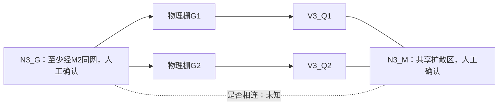

# 四MOS局部工作流与结论快照

日期：2026-10-15。本文件记录此次GitHub提交时的状态；实时任务入口仍为[CURRENT_TASK.md](../../CURRENT_TASK.md)。

## 已获人工确认的结论

- 当前局部AA/poly/CT可作为继续分析的材料基线；这是局部目视认可，不是精确像素真值或全片召回率验收。
- V1、V2各一个MOS，V3为两个MOS，共计四个局部MOS。V3中间M行为两个MOS的共用源漏扩散区。
- V3_G1、V3_G2的poly端部不相连，物理栅身份分别保留；修正版撤销误连正支持，并保留拓扑未知及CT下层未知。
- 用户结合M1/M2确认：V3两栅至少经M2接到同一个电气栅网络N3_G。M2尚无经过验证的局部配准，此结论明确归因于人工照片解释。
- V1/V2细支路与底部U形M1在当前局部保持断开；不据此宣称远处或其他金属层绝不相连。

**N3_G是否还与共享扩散区N3_M相连，仍未确认。** 原N3_MG将两栅与M合并的整体候选未获批准。当前将N3_G/N3_M分别标号以表达关系未知，不代表已经证明两者隔离。

可审计的人工复核记录：

- [三材料局部批准](../../benchmarks/material-review-feedback-v2.json)
- [四MOS与共享扩散区](../../benchmarks/local-mos-review-feedback-v1.json)
- [M位置与poly端部不连](../../benchmarks/local-terminal-review-feedback-v1.json)
- [poly修正批准](../../benchmarks/local-poly-repair-feedback-v1.json)
- [局部M1断开确认](../../benchmarks/device-m1-network-feedback-v1.json)
- [两栅至少经M2同网](../../benchmarks/device-m1-m2-topology-feedback-v1.json)

## 当前器件—网络解释

| MOS | 物理栅 | 电气栅网络 | 扩散端A | 扩散端B | 体端 |
| --- | --- | --- | --- | --- | --- |
| V1_Q1 | V1_G | N1_G | N12_A | N12_BG | 未知 |
| V2_Q1 | V2_G | N12_BG | N12_A | N2_B | 未知 |
| V3_Q1 | V3_G1 | N3_G | N3_A | N3_M | 未知 |
| V3_Q2 | V3_G2 | N3_G | N3_M | N3_B | 未知 |

表中V1/V2的端子映射、N3_A/N3_B外侧扩散到金属的映射仍为候选。人工确认的是上述限定关系，不能把整张候选表当成确认网表。A/B不指定源漏极性，NMOS/PMOS、体端和远处网络尚未识别。



## 实现与验证

- CT重提取使用显式narrow_vertical模式，legacy默认不变。后续工作以器件/接触区域/网络为主，逐CT诊断保留为历史，不作为推进前置门槛。
- 新增局部MOS、端子、poly修正、逐CT诊断、器件—M1网络检查入口；AI目视解释写入参数/候选记录，运行时脚本负责确定性校验、几何测量和导出，无外部视觉模型调用。
- poly修正撤销1385px正支持，分为1053px拓扑未知、332px CT下层未知；AA/CT、分隔带外poly及可见栅保护带不变。未知不是确认无材料。
- poly/M1局部环拟合及另一环检查：四角P95约6.14px、最大约6.35px，满足预设宏观预算；对应仍为AI候选，四角并非四个独立结构，不能据此宣称端子级精确配准。
- 尺寸输出只是可见交叠跨度/截面支持长度的px代理；部分窗口截断，不能当真实W/L或换算μm。
- 此次提交前：148项pytest通过；相关新增/修改Python文件Ruff通过；pip check无依赖冲突；git diff --check通过。

## 本机证据与复现边界

参数和人工复核记录纳入Git；批量runs、虚拟环境及人工标注工作文件留本机。八层源照片是早期已跟踪文件，本次不修改或新增。

导出入口示例：

```bash
.venv/bin/silicon-eye annotate materials --spec benchmarks/material-review-v2.json -o runs/material-next
.venv/bin/silicon-eye annotate mos --spec benchmarks/local-mos-review-v1.json -o runs/mos-next
.venv/bin/silicon-eye annotate terminals --spec benchmarks/local-terminal-review-v1.json -o runs/terminals-next
.venv/bin/silicon-eye annotate poly-repair --spec benchmarks/local-poly-repair-v1.json -o runs/poly-repair-next
.venv/bin/silicon-eye annotate networks --spec benchmarks/device-m1-network-v1.json -o runs/networks-next
```

这些参数绑定本机已有运行证据的路径与哈希，缺少人工标注及生成输入时不能从新克隆直接端到端重放；工具应明确失败。旧参数重放保留当时的候选状态，最新人工结论需叠加上述复核记录，不能只读取旧运行manifest。

下一步围绕N3_G与N3_M是否相连追踪M1/M2路径，并检查外部网络及体端；仅将会改变器件或连接结论的歧义交给人工。
