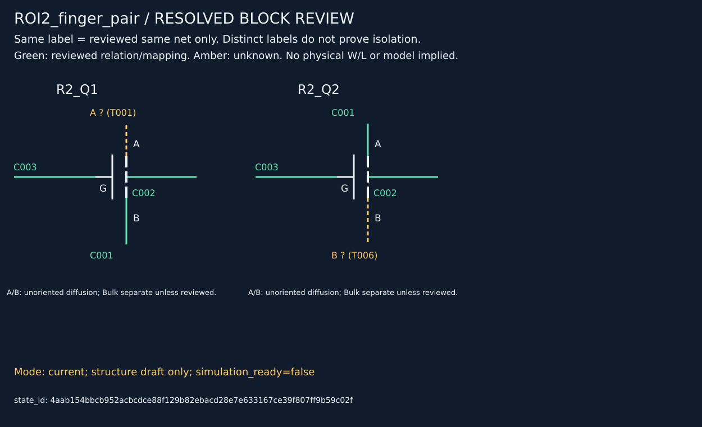

# ROI2复核结果与统一复核包快照

2026-10-16，按用户要求提交GitHub。实时入口仍为CURRENT_TASK.md。

## 已确认与未确定

- 两条相邻MOS栅指；poly局部未直接相连，两栅经M1共接。
- 中间扩散共享源漏，两体端共用；外侧扩散在M1无法确认，保持未知，不宣称隔离。
- AA条带片段、两条poly主体的材料身份和大致位置获确认，核心/包络精确边界仍为候选。
- M1→poly限定区域宏观透视叠图获确认；不扩为CT落点、精细材料边界或AA内部配准验收。
- N/P、源漏方向、体端所接电源、实际W/L和完整局部拓扑仍未确定，不自动归并为单个多指等效MOS。

[结构快照与本机依赖清单](2026-10-16-roi2-reviewed.json) · [四端表](2026-10-16-roi2-terminals.csv) · [同网矩阵](2026-10-16-roi2-matrix.csv)

## 工具结果

新增[统一状态入口](../block-review.md)及[联合复核包入口](../review-package.md)，一个请求绑定电路case、已验收配准profile和材料观察，从原图与固定矩阵重新导出图、表、叠图和manifest。候选/人工裁决、来源、范围、未知及冲突保持区分。

全套196项测试、相关Ruff通过。ROI2在只提供清单22项输入的新根中重放，bundle_id及17项产物哈希一致；V3仅电路包亦可重放。机械重放不是新照片识别或物理真值验收，运行时自动视觉提取仍未接入。

bundle_id: `652e15226f07fa308aad024fcd089cb97f65a57f5ae844b8a5d1b6be79182959`

block_state_id: `4aab154bbcb952acbcdce88f129b82ebacd28e7e633167ce39f807ff9b59c02f`

## GitHub可复现边界

此提交保存代码、测试、请求/裁决及静态结果，不提交整个runs或虚拟环境。当前请求仍依赖9项本机runs证据，包括原人工复核图、manifest及冻结transform记录；具体哈希见结构快照。**单独克隆仓库尚不能直接重放完整ROI2复核包**，需要补齐这些明确列出的证据输入。合成回归测试与V3已声明输入的重放不等于解决该发布依赖。

## 后续补充：版本化重放输入

上述9项本机依赖现已原字节归档到`benchmarks/evidence/roi2-reviewed-inputs-v1.zip`，清单和哈希见同名JSON。原始裁决/来源路径不改；使用[复核包说明](../review-package.md)中的显式恢复命令可在新检出中补齐。原“未发布”描述保留为快照形成时状态，不代表当前仍缺归档。
