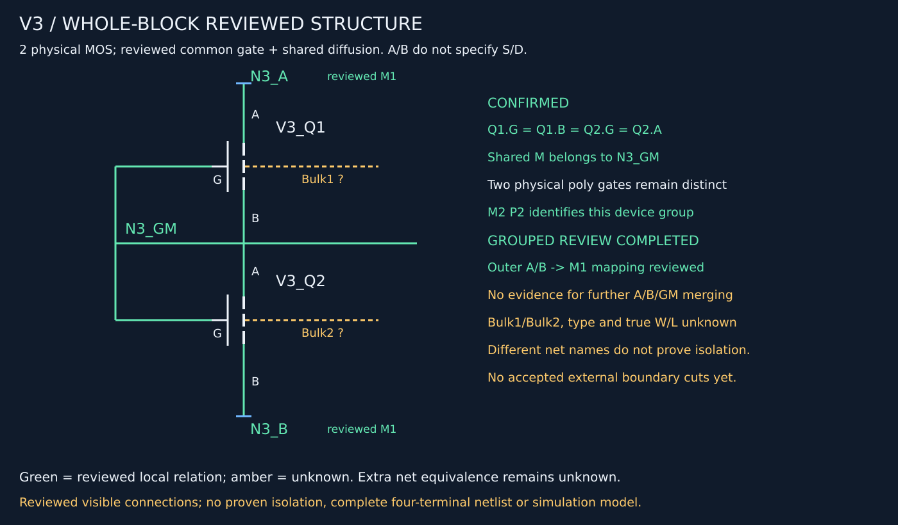

# V3局部结构复核与工作流纠偏快照

2026-10-16，用户已授权提交GitHub。本页保存代码版本对应的固定结论；实时任务见根目录CURRENT_TASK.md。

## 本轮结论

- V3包含两只MOS、两条物理poly栅，共用中间扩散区M。
- 两栅不经局部端部poly相连；电气上两栅与M共用N3_GM。Q1.G/Q1.B/Q2.G/Q2.A同网。
- 上外侧扩散A与M1上横条、下外侧B与M1下横条的对应已获用户确认。
- 用户表示没有额外并网证据；不新增A/B/GM并网，也不将其升级为“已证明三网彼此隔离”。
- M2-P2对应V3器件组已确认，具体分段/过孔路径仍未知。
- 类型、体端、源漏方向、实际W/L及外部去向仍未知；完成本轮可见连接成组复核，不宣称完整四端重建或仿真就绪。

用户反馈见[成组复核记录](../../benchmarks/v3-block-review-feedback-v1.json)。
[结构化器件组卡](2026-10-16-v3-reviewed.json)、[四端表](2026-10-16-v3-terminals.csv)、[同网矩阵](2026-10-16-v3-matrix.csv)来自同一已应用反馈的本机检查包。
矩阵K为确认同网，?为未知；两个未知体端不会因相同unknown字符串而合并。

## 本轮工具与流程

新增人工裁决应用、无Virtuoso的SVG/PNG示意图、独立原生观察窗口与上层诊断检查；这些是人工协同探索工具，不是自动器件提取流水线。
AI在会话中综合照片判断，脚本负责坐标、证据和一致性重放；runtime_ai_used=false不表示本次没有AI参与。

旧M2→M3探索只有一拟合/一留出结构，误差6.37–10.19px，只用于缩小搜索范围；没有增加确认电气连接。暂缓沿P2→M3→M4扩展。

## 下一阶段选择：先最小顶层架构设计

当前瓶颈是案例判断与渲染代码耦合，以及新反馈没有被所有导出入口统一消费。先明确以下接口，不继续优化V3单个CT或走线像素：

1. **器件组数据**：源图/ROI/坐标、器件、四端、逻辑节点与物理边界分别表达，未知不冒充独立网络。
2. **判断与裁决**：候选、证据、人工决定、适用范围和替代关系可追溯；身份确认、无并网证据、确认隔离分开。
3. **状态应用**：同一案例每次导出应用最新有效裁决，冲突明确失败，不因重跑旧入口丢失用户结论。
4. **统一输出和验收**：从同一份状态生成图、表、矩阵；区分结构稿、局部拓扑验收和仿真就绪。

先交数据契约、现有模块映射及最小迁移方案；再选未用于V3调参的小ROI检验流程复用，依据结果决定最少实现改动。
不建设通用调度平台，不先大规模重构、安装EDA/PDK或调用外部视觉服务。

## 验证与复放边界

本轮提交前164项测试、相关Ruff、依赖一致性和git diff --check通过。软件回归不代表照片/器件/拓扑全部准确。
所有新增benchmark的path/sha256绑定逐项检查；本页图/JSON与本机复核包按字节一致，CSV仅将行尾规范为LF，表格内容逐项一致。

runs/和.venv/保持本机，未新增上传源照片或照片衍生图。本页SVG是电路示意图；本次只额外固化可阅读的结论数据。
新克隆没有本机runs证据，不能直接端到端复放这些探索；部分新反馈当前通过本机组装稿应用，旧工具尚不会自动消费，正是下一步要设计解决的问题。

[顶层纠偏依据](../workflow-realignment-2026-10-16.md) · [开发计划](../development-plan.md)
