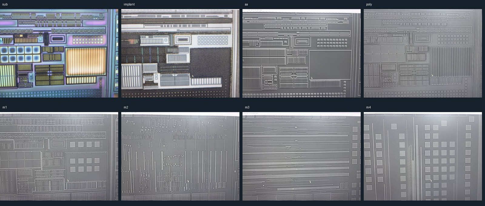

# 八张照片：输入初查与下一操作

2026-10-18。检查八张源图完整解码、尺寸、模式、字节数及 SHA-256，并查看全图缩略总览；未在此阶段做全分辨率逐区域材料判读。

[逐图机器清单与用途状态](../benchmarks/photo-stack/eight-photo-intake-v1.json)。这是设计样本记录，尚不是生产 PhotoStack schema 或自动门禁实现。

## 初查结论

- sub、implant、aa、poly、m1、m2、m3、m4 共八图，均为 RGB JPEG，5712×4284，解码和哈希建档完成。
- 同芯片逐层拍摄身份来源于此前用户说明及局部对应复核，不由图像同尺寸推出。图像内容与区域布局可供粗规划；拍屏畸变和各层视野差异仍需保留。
- AA/poly 有既往人工语义确认；金属层沿用项目来源及此前接口复核。sub/implant 暂只保留文件/项目标签，不新增掺杂、阱或 N/P 的确认。
- 没有独立 CT/V1/V2 照片。后续必须从相关源图找支持，建立语义层，不能宣称现成八张图就是八个干净材料层。
- 图中有重复指状阵列、矩形/梳齿结构和长金属路线，适合做区域规划；该总览不单独支持新增电阻/电容类型、数量或器件边界真值。
- 目前没有八层全图精确配准批准，没有有效区/共同覆盖的精确多边形，也没有真实尺度。10 px/μm 为旧假设，不作测量依据。

输入初查只允许进入区域规划；未批准全图精细跨层提取、自动并网或器件计数。

## 下一操作：先做整体区域规划图

在原生参考图上框选粗区域并分配 region_id，结合相关照片逐区判断 MOS 阵列、电容/电阻候选、主要互连、其他或未知。给出分类证据及用途，不把材料身份、功能分类和器件数量混为一项。跨层区域需显式映射，不能将一个 bbox 原样复制给所有照片。

交付一份带框总览和区域表，表内列参考帧、范围、类别/状态、支持层、遮挡/不确定性及优先处理顺序。第一轮无需确认每个 CT，也无需先全图精确配准。

随后首个重建样本使用已有 Q1/Q2 局部：历史入口为 [ROI2 源图检查窗](../benchmarks/agent-eval/roi2-seed-v1/input.json)，其中 AA [1770,2800,270,240]、poly [1700,2670,270,240]、M1 [1590,2730,800,500] 均为各帧原生 xywh。它们只是历史观察窗口，不是相互对齐的材料边界；细化范围后重新建立有用途的局部对应。

首轮 AA/poly/CT/M1 样稿需同时交付：材料掩膜、未知图、有效覆盖、对象 ID、来源、叠图和局部检查结果。后续 V1/M2 仅在上述数据足以支撑端口归属后加入。验收重点是保留真实间隙、共享扩散和 gate CT 归属；不把旧 v14 错误 gate 入口复制到新结果。

本次尚未生成区域分类框或材料掩膜；下一步是区域规划图，之后才做局部分层复原。没有新物理连接或尺度批准。

## 区域规划已产出

本页初查后的[区域规划 v1](region-planning-v1.md)已生成，含 PDK 回查指南、21 个候选/未知区域和八帧复核页；原“尚未生成”是初查时状态。分类仍待复核，无材料掩膜或新增物理连接批准。实时下一步以 CURRENT_TASK.md 为准。
