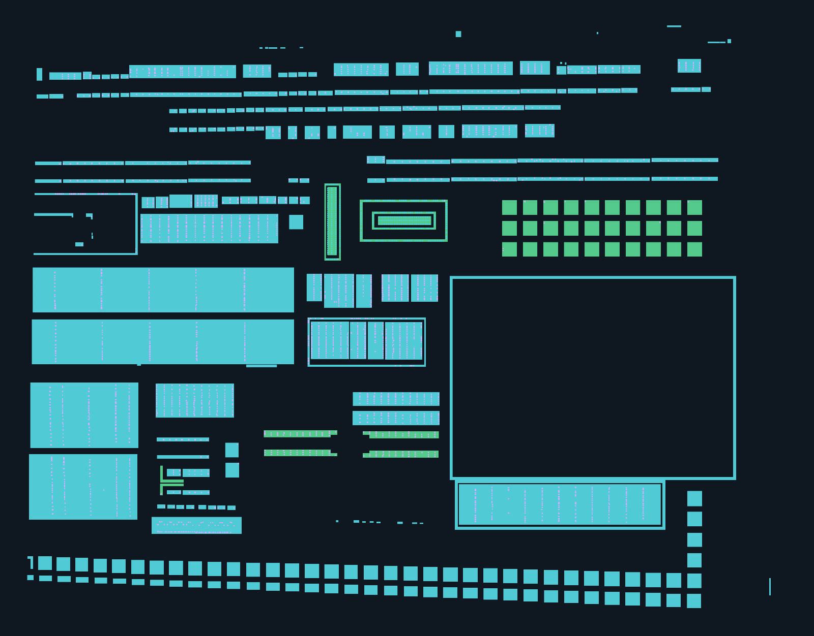
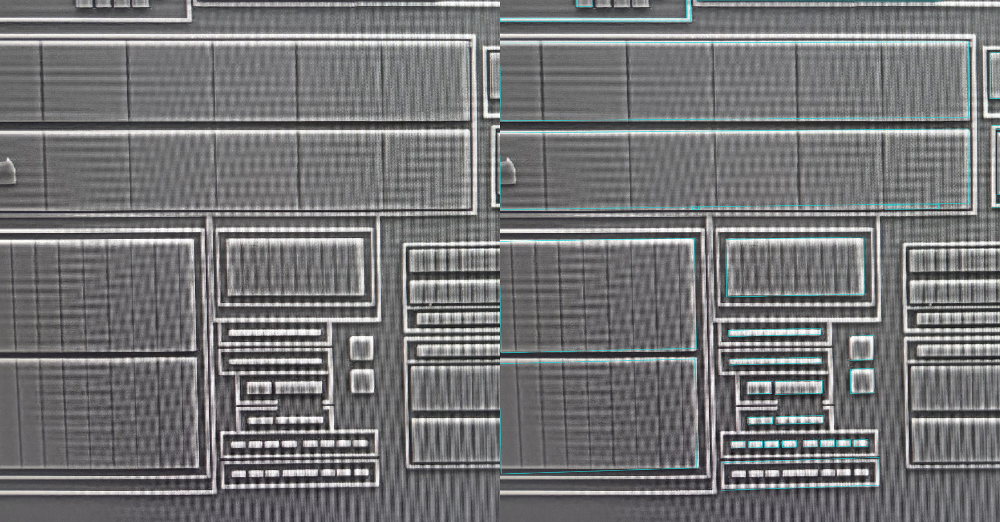
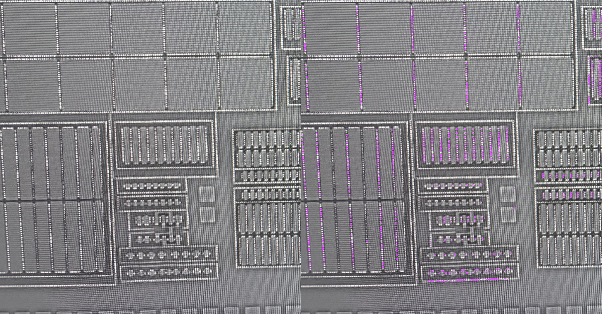
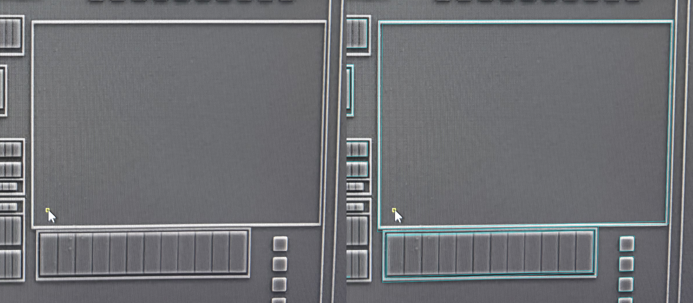

# 全幅 AA＋CT：规则几何扩展与覆盖复核 v1

当前用户反馈已转入[顶层 v5 纠偏](architecture/photo-stack-workflow-v5.md)：本稿保留为开发候选和反例，暂停下列 F01–F12 人工验收。先补结构组规律与孔合法区质量门，再交新版。下文是当时的复核清单，不是当前待办。

2026-10-18。全幅候选已扩展，新增部分待人工复核；全幅物理完整性尚未验收。既有 519 个对象及全部人审字段保持不变，P01–P06 和旧环/阵列不重问。

[打开单页复核入口](../runs/full-scene-aa-ct-v1h/index.html)：同页切换规则版图、AA 原图回投、CT 所在 poly 原图回投；可调整透明度、显示 AA 编号、切换 CT/待核落点及残余证据提示。F01–F12 按从左到右、从上到下覆盖可见 AA 场景，仅是显示窗口，不切断材料或网络。完整画布和来源照片尺寸分别处理。

## 本次扩展

| 项目 | 记录数 | 含义 |
| --- | ---: | --- |
| 既有 AA | 41 | 含两个已审延续片段，保留原几何和人审 |
| 新增 AA | 263 | 候选矩形、环和正交多边形，不是独立岛/器件数量 |
| 新增 CT 正几何候选 | 2743 | 可见亮点、形状支持及当前 AA 几何落点同时满足工作条件，未经人工批准 |
| 新增 CT 待核落点 | 928 | 靠近边界或 AA 归属有疑点，默认不显示，按需勾选 |
| 未解决 AA 观察 | 100 | 轮廓复杂、拟合越限或与既有几何冲突，不自动补形/连通 |
| 尚未分配给 AA 的来源亮点 | 7051 | 可能含其他材料上的 CT、纹理、噪声及未建模 AA，不作为 CT 真值 |

当前共有 304 个 AA 几何、4149 个 CT 位置记录。CT 记录中 3142 个为正几何候选/旧正几何，1007 个为未知（本次 928、旧算法疑点 79）。旧 120 个 CT 的有范围人审和三环整体排列批准继续有效；上述统计不是物理孔总数。亮点观测共 11339，其中 617 被接近/几何重叠规则抑制；这不证明它们是物理重复孔。



绿色为既有 AA，青色为新增 AA；蓝色为旧正几何 CT，紫色为新增正几何 CT。缩略图用于看结构与覆盖，不能用其数孔或判断精确尺寸。空白处未分类，不能判为无材料。

## 一次性宏观复核清单

请按 F01–F12 反馈“已建模结构合理”或指出需要修正的对象/位置。优先看：AA 是否误连、缺口/环内孔是否保留、长条与重复结构是否合理，以及 CT 行列是否落在对应 AA 上、有无明显整排错位或遗漏。无需逐孔批准；100 条未解决观察已单独保留，不把候选批准扩大为完整性批准。

| 窗口 | 位置 | 涉及新增 AA | 涉及未解决观察 |
| --- | --- | ---: | ---: |
| F01 | 第1行第1列 | 42 | 12 |
| F02 | 第1行第2列 | 64 | 15 |
| F03 | 第1行第3列 | 31 | 15 |
| F04 | 第1行第4列 | 18 | 12 |
| F05 | 第2行第1列 | 12 | 32 |
| F06 | 第2行第2列 | 16 | 22 |
| F07 | 第2行第3列 | 6 | 6 |
| F08 | 第2行第4列 | 1 | 6 |
| F09 | 第3行第1列 | 38 | 10 |
| F10 | 第3行第2列 | 35 | 22 |
| F11 | 第3行第3列 | 28 | 8 |
| F12 | 第3行第4列 | 18 | 11 |

跨窗对象会重复计入，表内数字不可相加作为对象总数。[覆盖清单](../benchmarks/full-scene-aa-ct-v1/coverage-v1.json)提供每个窗口的原生 AA 范围、对象 ID 和未解决观察 ID；页面表格可直接切窗。

可以一次回复：

```text
F01：……
F02：……
F03：……
F04：……
F05：……
F06：……
F07：……
F08：……
F09：……
F10：……
F11：……
F12：……
```

## 原图证据与已知限制

下图左半为原图、右半为候选回投，保留宽视野以判断位置；仅新增候选画线，未显示不等于无材料。





两张图各用自身原生坐标，不能把它们直接叠放视为精准配准。单页切层的显示窗口通过既有候选变换对应；全图精确对齐仍未验收。



静态回投发现旧有效区未完整遮住鼠标指针，已在新参数中补充原生遮挡范围并移除三个伪 AA，未改变旧证据参数或原照片。

- 左侧长条暗内部和右侧大环等明确结构由 AI 录入八项源图几何假设；其余候选用既有全幅观察支持初始化，再拟合正交线段。没有接入外部视觉模型或声明任意 AA 自动识别已解决。
- 新增 AA 不与已审/其他新增几何接触或重叠；存在冲突则暂缓，不能凭规则化图形顺眼就自动接上。片段延续仍是未知，不是物理断点。
- CT 采用局部亮点与形状支持交集，再按当前 AA 归属作有限行列规则化。只移动已观察位置，不凭等距补出缺失孔；8 个相对单位的方孔是显示/建模假设，尺寸未测量。落点通过不代表材料身份、电气连接或实际孔尺寸已验证。
- [未解决 AA 原始记录](../benchmarks/full-scene-aa-ct-v1/deferred-AA-v1.json)共 135 条，其中 35 条为已建模结构的重复观察，剩余 100 条待处理。与父模型相交但不确定同属一块的轮廓，保持冲突，不覆盖已审对象。
- “残余证据提示”显示观察初始化支持中距离当前 AA 几何超过工作容差的部分；它既不覆盖全部未知，也不是漏检真值或覆盖率。AA/CT 来源有效覆盖分别保存，屏幕遮挡与照片外无证据仍为未知。
- 沿用既有变换，未完成整图局部畸变校正。画布由 5712×4284 扩为 5860×4587，原点和旧对象坐标不动，以容纳变换后的完整有效源图；源照片仍各为 5712×4284。相对单位不换算 µm，不输出工艺精确 GDS。

[AA 全幅来源回投](assets/full-scene-aa-ct-v1/aa-source-overlay.png) · [CT 全幅来源回投](assets/full-scene-aa-ct-v1/poly-source-overlay.png) · [右侧 CT 宽视野](assets/full-scene-aa-ct-v1/poly-right-wide.png)。

## 数据、重放与技术核查

[冻结模型](../benchmarks/full-scene-aa-ct-v1/model-v1.json)、[输入与参数](../benchmarks/full-scene-aa-ct-v1/spec-v1.json)、[核查记录](../benchmarks/full-scene-aa-ct-v1/result-v1.json)。源图、父模型和初始化参数均用哈希锁定；不依赖旧 runs/ 中的临时 JSON 作为输入。模型是主数据，SVG/像素图从模型生成。

```bash
.venv/bin/python -m silicon_eye.scene_geometry \
  --root . --spec benchmarks/full-scene-aa-ct-v1/spec-v1.json \
  --output runs/一个新目录
```

全项目 287 项测试及相关 Ruff 通过。核查包含：519 个旧对象逐字段不变、旧 AA 像素图不变、原图/输入/代码/输出哈希、全部 AA 正交且多边形有效、新增 AA 分离、新 CT 不重叠或接触、来源亮点去向数量一致、SVG 原生尺寸、HTML 静态引用和页面脚本语法。浏览器交互未自动实测；此前本地 file: 自动预览被策略拒绝，未绕过。软件检查不替代物理验收。

下一节点是按上述清单复核新增宏观结构，再修正误提与未覆盖的 AA/CT；不开始其他材料、并网或封装新 skill。当前未提交或推送 Git。
