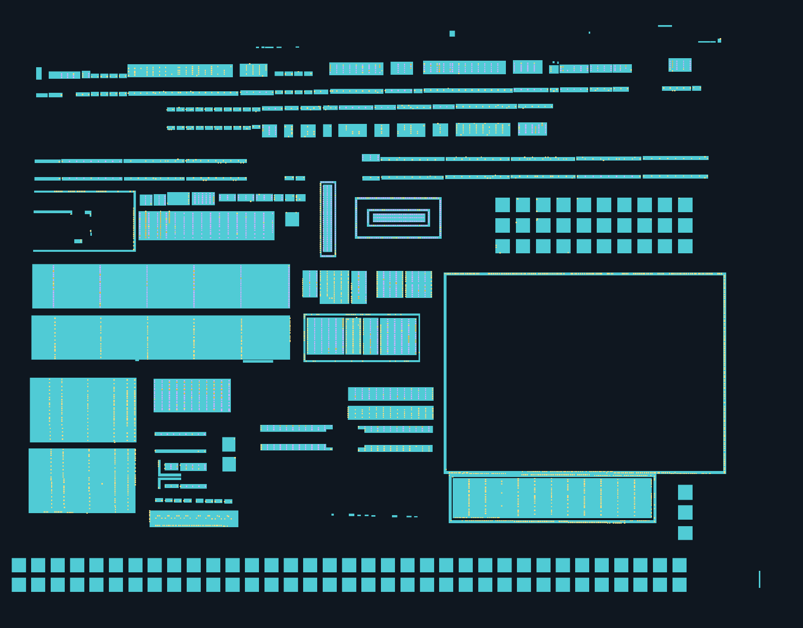

# 保留几何，扩展整张照片的 AA＋CT 规则候选

最新状态：F01–F12 已完成[有范围人审](../benchmarks/full-scene-regular-v1/human-review-v1.json)，整图材料完整性未通过。按[AA 优先纠偏 v6](architecture/aa-first-reconstruction-v6.md)先修复 AA，CT 延后；以下保留被审版本的原始技术说明和结果，不代表修复完成。

2026-10-18。已按“保留几何并将提取范围扩展到整个图片的AA和CT”继续执行。[打开全幅切层复核页](../runs/full-scene-regular-v1d/index.html)。本版从既有全幅观察扩展工作场景，原 D01/R01/T01/T02 的 **195 个对象逐字段保持不变**，没有因 T02 的亮度峰回投偏差改形或重新排列它们。

全幅范围已处理，物理完整性尚未验收；100 条原 AA 观察仍待解决，另有 1 处坐标边界冲突。原始八图未修改；本轮实际材料证据使用完整 AA、poly 两张照片，CT 位于 poly 来源照片中，不是独立 CT 原图。其余层没有开展完整重建或并网。

## 如何核对

同页可切换规则版图、AA 原图回投、poly/CT 原图回投。默认显示全幅，F01–F12 只是显示窗口；可直接跳回 D01/R01/T01/T02、突出保留几何或打开旧全幅候选作对照。透明度降为零即可看原照片。AA 编号按需显示，避免整图标签遮挡。

| 显示 | 含义 | 记录数 |
| --- | --- | ---: |
| 青色 AA | 当前活动规则几何，不等于独立材料岛或器件数 | 303 |
| 紫色 CT | 既有正几何或本次来源/重复规律支持的候选，完整合法性未确认 | 1671 |
| 橙框 CT | 模板推断，保留来源缺失状态 | 181 |
| 浅黄框 CT | AA 范围关联但边界、来源重合或重复规律待核 | 2432 |
| 红框亮点（默认关闭） | 材料归属尚不明确的来源候选，不判为 poly CT | 6581 |
| 红色 AA 边界 | 与保留阵列相邻的旧片段冲突，单独显示，不进入活动 AA 层 | 1 |

工作 CT 层有 4284 个位置记录，包含推断和待核；另有 6581 个未分类位置。它们都不是物理孔计数。全幅源亮点 11339 个全部有唯一处理去向；接近/重叠抑制只表示几何冗余规则命中，不证明是同一个物理孔。



总览不画默认关闭的材料归属未知亮点，也不将未建模空白解释为无材料。底部阵列保持统一尺寸/节距；已审台阶、折线及其延续语义继续保留。

## 本次进行了哪些扩展

- 将局部验证模型的 72 个 AA、123 个 CT 原样接入全幅；保留此前 478 个 CT 记录及其原状态，共 601 个保留 CT，彼此无几何重叠。
- 合并其余全幅 AA 观察；对有明确同尺寸/同行规律的矩形组和未审环提出共享参数修订。13 个组提案中 12 个应用为候选，1 个因碰撞或变化越限暂缓；不凭规则化自动填平凹角、合并材料岛或补成电气连接。
- 底部阵列与三个旧边缘片段原先分属不同成像拟合，直接混合会相交。两个照片边缘片段按保留阵列的相邻列规则生成完整方块候选，超出照片证据的部分仍是推断；另一个旧 AA-F00128 与上方邻居仍有冲突，完整旧几何保存在[冲突记录](../benchmarks/full-scene-regular-v1/boundary-AA-conflicts-v1.json)，未从证据中删除，也未强行并入活动材料。
- 遍历整张 poly 来源照片的亮点观察，采用显式记录的局部亮度加权中心作为新候选参考；原亮度峰位置同时保留。该定义来自前轮敏感性诊断，尚不是独立孔中心真值，未触碰保留几何。
- 在 178 个 AA 关联组中生成 CT 位置；支持共同行列或周期相位的组使用共享坐标，不把一个亮点的小幅偏移独立画成歪行。只拟合有观测的坐标层级，不凭间距无依据增加整列孔。交叉模板中少量缺位可提出推断，数量受预算限制，且不能落入 AA 内孔或几何留边禁区。
- 生成 3683 个新 AA 关联位置；对无法建立可靠规律、边界或唯一来源的项保留待核。AA 之外的候选另列材料归属未知，避免把空缺 AA 或 poly 表面的亮点混成已经确认的 AA 接触。

这里只覆盖相对几何及候选材料关系。缺沟道、上覆导体、真实工艺和尺度时，不能声称 CT 全部合法或正式 DRC 已过；孔不自动并网。

## 原图回投

[AA 全幅来源回投](assets/full-scene-regular-v1/aa-source-overlay.png) · [poly/CT 全幅来源回投](assets/full-scene-regular-v1/poly-source-overlay.png)。静态图只画对应材料候选，原照片字节保持不变。

局部样稿沿用各自的照片映射，其他对象使用既有候选全局映射，逐对象保存映射归属。模型仍处于同一 5860×4587 场景坐标，但这些局部映射尚未拼成全幅一致变形场，跨组落点和连接不能据此直接判定。两张原照片分别保持 5712×4284，原生坐标和版图坐标分开。

T02 的原回投数值失败记录保留：[诊断](t02-gate-diagnosis-v1.md)。本版依据用户新指令保留几何、扩大范围，未追溯改成“原门已通过”。亮度峰残差仅作定位诊断，不能自动否决宏观结构；这也不代表任意回投错误可被忽略。

## 证据与运行

[输入参数 v2](../benchmarks/full-scene-regular-v1/spec-v2.json)、[冻结全幅模型](../benchmarks/full-scene-regular-v1/model-v1.json)、[统计与限制](../benchmarks/full-scene-regular-v1/report-v1.json)、[技术核查](../benchmarks/full-scene-regular-v1/verification-v1.json)、[用户保留指令及范围](../benchmarks/full-scene-regular-v1/retention-instruction-v1.json)。模型直接锁定版本化全幅观察、195 个对象的验证模型、旧已审父模型和来源亮点；不依赖旧 runs/ 临时 JSON。每个位置有来源或推断状态，组不切断全幅材料或网络。

```bash
.venv/bin/python -m silicon_eye.regular_scene \
  --root . --spec benchmarks/full-scene-regular-v1/spec-v2.json \
  --output runs/一个新目录
```

输出包括模型、分组、逐来源去向、未解决 AA、边界冲突、各帧 SVG、AA/CT 分状态像素图和复核页。`CT-all-candidates-layout.png` 包含工作层候选、推断及待核，不能当确认接触掩膜；`CT-layout.png` 只包含当前正几何候选。主数据仍是矢量与状态记录。

全项目 305 tests、相关 Ruff 和 diff 检查通过；核验 195 个保留对象逐字段不变、源图及全部输入哈希、11168 个对象唯一/有效/正交、303 个活动 AA 与 10865 个 CT 同层分别无交叠、11339 个来源去向唯一、27 个 SVG 原生尺寸及 44 项输出清单。页面脚本语法和静态引用检查通过，浏览器交互未自动实测；未绕过既有本地 file: 自动预览限制。软件通过不是整图物理完整性通过。

原待人审节点已收到 F01–F12 的完整反馈。当前下一节点改为全幅 AA 环/器件/dummy 覆盖与隔离修复，CT 重算推迟至 AA 独立验收。100 条未解决 AA 与 1 处边界冲突继续保留。不恢复逐像素修补为主的路线，不开启金属/网络阶段。当前工作未提交或推送 Git。
