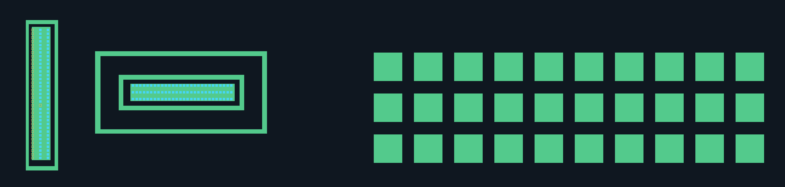

# AA＋CT 规则几何样稿 v1

2026-10-18，冻结首版候选记录。后续已收到有范围的人审及环上 CT 漏检反馈，当前状态见 [v2 补充稿](geometry-reconstruction-v2.md)；以下保留首次观察，不作为当前待审入口。

[打开规则版图／AA 原图／CT 原图单页](../runs/geometry-reconstruction-v1b/index.html)。支持宽视野样稿切换、完整画布、AA/CT/未知位置、编号、透明度。浏览器 file: 自动化曾被策略拒绝，未绕过；本页交互未实测，静态几何、SVG、回投图与引用已核查。

## 这次实际改变

主数据改为 [model.json](../runs/geometry-reconstruction-v1b/model.json) 中的矢量对象和阵列；[layout.svg](../runs/geometry-reconstruction-v1b/layout.svg)、AA/CT 像素图由这些对象生成。没有把原照片的模糊边缘作为最终几何。

35 个 AA 几何：5 个结构样本加 30 个 dummy AA。它们是同一完整 5712×4284 版图空间中的稀疏对象，不是 35 个器件；未建模的地方不能理解成没有材料。没有按区域建立互相独立的版图或网络。

| 编号 | 几何假设 | 需要核对 |
| --- | --- | --- |
| AA-G001 / AA-G002 | 长矩形环及其内独立长条 AA | 环、间隙与长条的关系 |
| AA-G003 / AA-G004 / AA-G005 | 两个嵌套矩形环及内独立 AA 条 | 中央条不能连到外环；未包含最外层周边结构 |
| AA-G101–AA-G130 | 3 行×10 列 dummy AA | 正交、等尺寸、等间距是否合理 |
| CT-A01 | 长条 AA 上 3 列×35 行方孔位置假设 | 是否符合实际行列；靠左一列落点接近 AA 边界 |
| CT-A02 | 中央 AA 条上 3 行×28 列方孔位置假设 | 行列规律、来源落点；不能据此推出电气连接 |

189 个是提出的阵列位置，不是提取到的真实通孔数。153 个位置有亮度支持且拟议方框落在对应 AA 内，仍为候选；36 个待核。其中长条阵列有 33 个位置亮点存在但拟议方框未完整落在重建 AA 内，3 个位置亮度支持不足。原因可能涉及边界假设、孔尺寸、配准或遮挡，暂不裁决。橙色空框不会写进 CT 正支持像素图。

## 来源与约束

- 原始 aa.jpg、poly.jpg 不变；CT 来自 poly 照片，但本轮不重建 poly。
- 五个结构的角点由 AI 观察录入；dummy 包络和 CT 拟合初始化借用上一轮掩膜/亮点支持。借用结果不是材料真值。所有输入已固化在 benchmarks/geometry-reconstruction-v1；运行不依赖旧 runs/ 的 JSON。
- 用 dummy 阵列 30 个中心拟合 AA 原生→版图的候选单应变换；阵列目标间距 148×151、等尺寸 104×104 是相对单位下的工作假设，不是工艺参数。锚点集中在 dummy 区，外推精度未独立验收。
- AA 角点转入版图空间后拟合正交矩形，孔洞独立保存；不改变独立对象之间的分离。跨对象接触/重叠会拒绝输出，不能自动补成连接。
- CT 用单亮点支持拟合两个等距正交轴，随后逐阵列位置回查原图亮度/局部对比；8×8 方孔尺寸是假设，不是精确孔边界。亮度支持不能排除噪声或其他材料的亮点。
- 模型保存每个 AA 的原生观测、规则边界与回投位移；每个 CT 位置保存原图坐标、亮度、未知原因、阵列和 AA 假设关联。电气连接保持 unknown。

当前 dummy 中心拟合残差中位数约 1.13 px、最大约 1.58 px；AA 规则角点相对录入角点的最大回投位移约 5.25 px。前者是开发拟合值，后者是约束引入的位移，都不是独立真实误差或验收阈值。全图镜头畸变、尺度与材料精度未通过。

## 重跑

```bash
.venv/bin/python -m silicon_eye.geometry_reconstruction \
  --root . --spec benchmarks/geometry-reconstruction-v1/spec-v1.json \
  --output runs/一个新目录
```

模块不调用外部模型，不覆盖原图或已有目录。本轮是 AI 观察＋固定脚本拟合/渲染，不是已实现通用自动版图复原。

下一步仅审几何方法与关键关系，集中指出不合理约束。通过后再增加复杂正交形状和全幅对象覆盖，再推进 poly、金属和跨层连通；不因页面看起来整齐就进入自动并网。

## 软件与静态检查

全项目 271 项测试、相关 Ruff、diff 空白检查通过。新增六项行为测试覆盖正交化、嵌套环/独立岛及绘制顺序、吸附导致接触时拒绝、已知透视阵列恢复、缺点阵列拟合、没有原图支持时不补孔。固定输入、输出哈希、SVG 尺寸/语法、页面静态链接及原图哈希均已核查；软件检查不能替代人工材料验收。

[冻结几何模型](../benchmarks/geometry-reconstruction-v1/model-v1.json)与 [运行核查记录](../benchmarks/geometry-reconstruction-v1/result-v1.json)保留在版本管理范围。下面是由几何生成的样稿整体，不是照片分割图：


