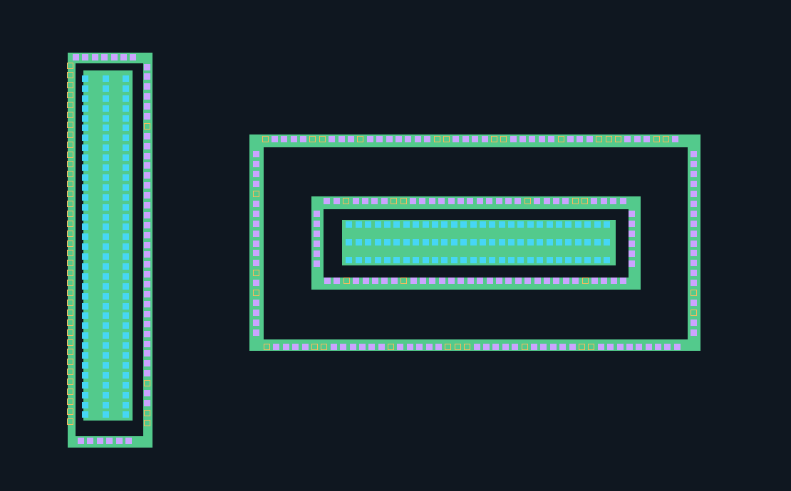
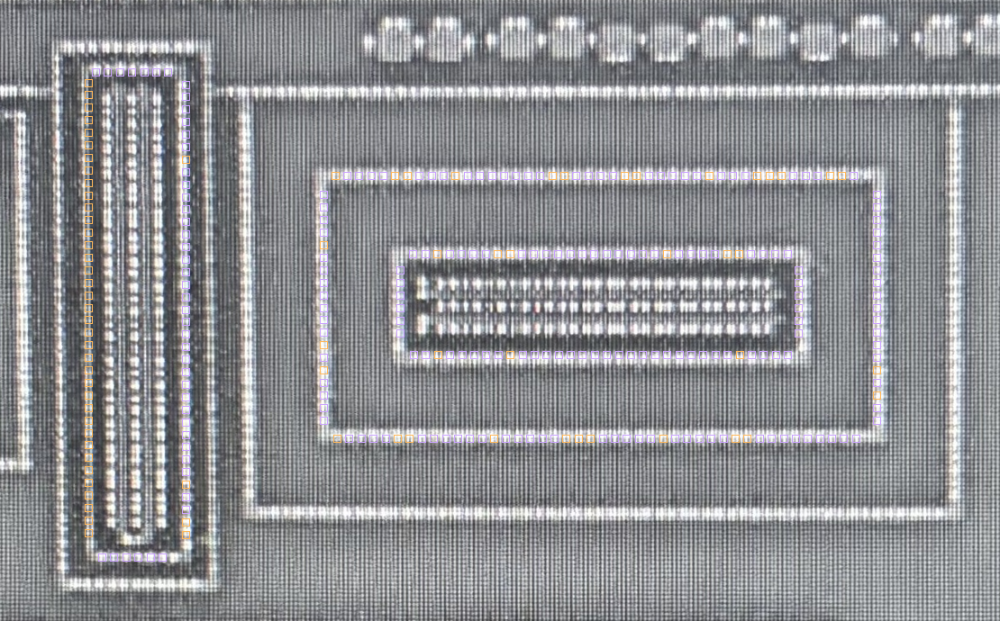

# 规则几何样稿 v2：补充环上 CT

2026-10-18。承接用户对 v1 的确认与漏检反馈。本版随后已获排列/可见覆盖的有范围验收，见下文；页面与运行记录保留验收前候选状态。[打开最新三视图复核页](../runs/geometry-reconstruction-v2c/index.html)。

## 已录入的人工判断

[原话与有范围裁决](../benchmarks/geometry-reconstruction-v1/human-review-v1.json)绑定冻结 v1 模型哈希：

- 35 个 AA 几何的结构/分离及 dummy 等尺寸、等间距排列合理；不转化为精确边界、尺寸或器件数量批准。
- 横向 AA 条的 CT-A02 阵列正确；原版 36 个橙色 CT 位置正确。分别保存 84 与 36 个 CT 位置的存在/大致定位确认；不是逐孔尺寸批准。
- 其余原有 CT 不因这次反馈自动全部升为人工确认。原文“横向长条”按横向 CT-A02 对应；未扩大为 CT-A01 其余 69 个蓝色位置的整批批准。
- 指出竖向和横向环存在 CT 漏提，新增 CT 位置仍为候选。

新版本直接读取冻结 v1 几何后应用人审记录，未重新拟合原有对象。35 个 AA 和 189 个原有 CT 的边界/坐标逐项一致。原橙色的 36 个 CT 转入已审存在状态，原算法给出的边界/亮度问题另外保留；不扩大 AA 来吞并落点。

## 新增范围与核对方法

本次仅补既有 AA-G001、AA-G003、AA-G004 三个环的四条边，合计 12 条一维 CT 候选序列。不是完整芯片或所有环的重建；环转角和更外侧尚未建模结构不宣称覆盖。

| 页面颜色 | 含义 |
| --- | --- |
| 绿色 AA | 既有结构与排列已审，精确边界仍为重建假设 |
| 蓝色 CT | 既有位置，包含已审 120 个与其余 69 个候选；具体状态见 model.json |
| 紫色 CT | 新增环上 CT 候选，尚未人工批准 |
| 橙色空框 | 新增位置的亮度/周期性/AA 落点待核，不是断言缺孔 |

新增环上序列可以独立开关；仍可切换规则版图、AA 原图、poly 原图与透明度。无需重审已确认的 AA 或 dummy，也不要求逐孔审阅。只需整体核对竖环和两横环的 CT 排列/遗漏是否合理。



下面是 poly 来源照片经过候选变换显示到版图坐标，并叠加新增位置的静态检查图；是辅助检查，不能当作原生像素证据或全图畸变已消除的证明。原生照片对照见页面。



## 方法与仍有的未知

上一版只生成两个实心 AA 条中的 CT 阵列，未建立环边 CT 序列，这是覆盖遗漏。环上密集亮点可能被亮点连通块方法合并或过滤，不能依靠原筛选结果穷尽孔位。

本次在既有 AA 环几何上提出一维等距序列，横向间距借用 CT-A02 的工作值，纵向借用 CT-A01 的工作值。仅拟合沿边相位及有限法向偏移，再逐位置回查原 poly 照片的亮度、邻域对比和周期峰谷差。均匀亮线不能仅凭亮度生成正支持 CT。周期规律和固定方孔尺寸仍是模型假设。

AA 落点现检查实际矩形环材料，排除内孔；不能只检查环的外包矩形。亮点支持足够但拟议方孔跨出 AA 材料的，保留为落点未知。未改变 AA 边界、孔尺寸或变换来强行通过。

共提出 289 个新增环边位置，210 个满足当前脚本亮度/周期性/环材料内落点规则，79 个待核。含旧版位置后共 478 个阵列位置，其中 399 个为已审存在或算法候选，79 个待核。这些是版图工作对象数，不是独立测量的物理通孔数或准确率。新增位置尚未人工验收，电气连接全部未知。

## 验证与恢复

完整 275 项测试、相关 Ruff 通过。新增四项测试覆盖：环内孔不能接收 CT、人审只更新指定对象的状态且不改几何、周期亮点中缺孔保持未知、均匀亮线不生成正支持 CT。所有原有坐标、输出清单哈希、原图哈希、SVG 与静态链接已核查；浏览器交互未实测。

[冻结模型 v2](../benchmarks/geometry-reconstruction-v1/model-v2.json)、[运行核查记录](../benchmarks/geometry-reconstruction-v1/result-v2.json)。重跑：

```bash
.venv/bin/python -m silicon_eye.geometry_reconstruction \
  --root . --spec benchmarks/geometry-reconstruction-v1/spec-v2.json \
  --output runs/一个新目录
```

当时待审项为新增环上 CT；后续验收结论与当前下一步见下节。

## 排列验收完成

用户回复：“排列合理且没有明显遗漏。”[人审原话与范围](../benchmarks/geometry-reconstruction-v1/human-review-v2.json)绑定冻结模型哈希，范围为三环十二边序列的整体排列及样稿可见范围内未发现明显遗漏。

结合此前 AA 结构、独立岛/环分离、dummy 等尺寸/等间距排列确认，本轮规则几何样稿的结构与排列质量门通过。这里的通过不表示每个孔尺寸、像素边界、转角覆盖、全图材料覆盖或电气关系已经确认。

[带人审状态的模型](../benchmarks/geometry-reconstruction-v1/model-v2-reviewed.json)与 [本次状态核查](../benchmarks/geometry-reconstruction-v1/review-verification-v2.json)单独保存，未覆盖旧模型/运行记录。全部 513 个几何对象的坐标和算法状态均未改动；79 个局部亮度/落点算法疑点继续保留，但不再作为整体排列待审问题反复询问。此次是人审状态写入，未改算法，不重复全套软件测试。

下一步转向阶梯形/折线 AA 等正交多边形表达验证，再在同一全幅空间扩展 AA＋CT 覆盖。继续保留原图回投、独立对象分离及未知状态；暂不增加其他材料层、网络分析或封装新 skill。
