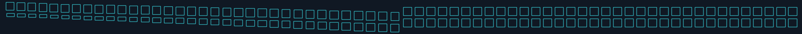
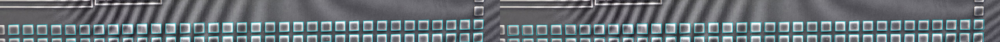
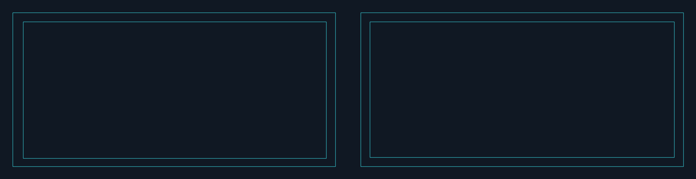
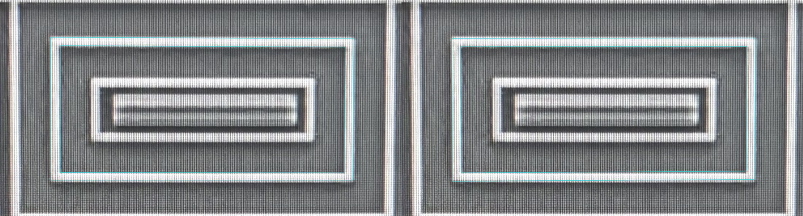
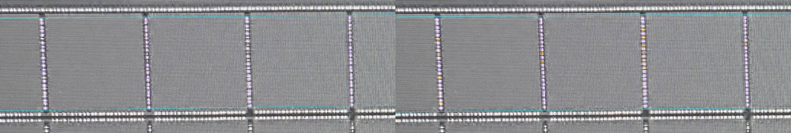
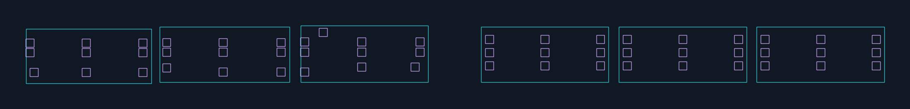
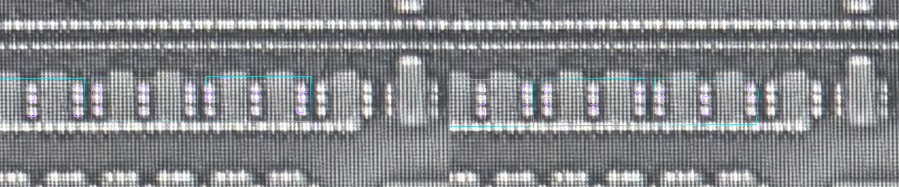

# v5 验证：结构更规整，质量门拦截了一个真实失败

当前用户已要求保留几何并扩全幅，见[新全幅结果](full-scene-regular-v1.md)。下文是原验证与失败记录，不作为当前范围限制，原数值未覆盖。

2026-10-18。[打开同页旧新对照与切层入口](../runs/group-constraints-v1f/index.html)。左侧旧候选，右侧共享参数重建；可切规则版图、AA、poly 原图，透明度为零时直接看原图。橙框是推断孔，红色是来源槽位歧义。

本轮结论：阵列、闭环与接触模板的构造约束有实际效果；9 类 20 个受控错误均被拦截。但新增 T02 的照片证据门失败，T01 的完整孔合法性仍待定，不能进入全幅扩展或网络追踪。新几何尚未人工验收。

## 实际照片结果

阈值在初版输入中先行冻结，后续没有因失败放宽。下表是同一芯片开发样本的留出观测偏差，不是测量精度、PDK 容差或盲测识别率。

| 样本 | 结构与范围 | 规则几何 | 留出点数 | 回投中位 / P95（px） | 当前结果 |
| --- | --- | --- | ---: | --- | --- |
| D01 | U04 底部 dummy，2×34 个 AA 方块 | 同尺寸、同基线、等节距、成员分离 | 54 | 2.96 / 8.22；门限 8 / 16 | 当前结构/观测检查通过，新几何待审 |
| R01 | 原 AA-G003 连续环 | 等宽闭环、内孔保留 | 4 | 1.80 / 3.99；门限 8 / 8 | 当前结构/观测检查通过，新几何待审 |
| T01 | U01 宽 MOS 电容接法，内部四列 CT | 每列 24 个模板位置，等距等尺寸 | 17 | 3.31 / 5.43；门限 4 / 8 | 观测门通过；沟道/上覆金属等依赖缺失，整体待定 |
| T02 | M03 MOS 区域三个相邻 AA 单元，每单元 3×3 CT 假设 | 单元间节距与单元内孔距分别建模 | 9 | **5.20 / 5.60；门限 4 / 8** | **中位偏差超限，照片证据门失败，禁止放行** |

T02 说明“模板看着规整”不足以通过：可能是亮点中心不准、槽位对应/孔数假设有误，或组参数/成像模型不足。现有结果不能判定具体是哪一项，也不能为了过门直接拉伸或放宽阈值。保留失败数据，下一轮先复核来源亮点与模板对应。

## 旧新图对照

以下图片均左旧右新，保持等比例，不以非等比例显示把正方形拉成长方形。显示窗口只用于观察，所有几何仍保持场景坐标。完整原图：[AA](../data/test_chip/tile_full/aa.jpg)、[poly/CT](../data/test_chip/tile_full/poly.jpg)。

### D01：整组阵列





原版两排逐渐偏斜、下排高度随照片截断变化；新版使用同一个方形原型与行列节距。下排 34 个观测受照片下沿截断，完整方块是模板推断，不代表照片外已经看到。拟合原型尺寸只使用完整上排。

这一步还发现并修正了早期协议漏洞：截断方块中心会向照片内部偏移。初版中心点协议不能作为最终证据门；最终版本使用训练单元的完整角点拟合照片变换，以其他完整单元角点和被截单元可见上沿作留出检查，排除截断中心和下沿。已用于估计节距的边不冒充留出点。这是开发中修订协议的结果，留出集已经参与开发，不是未见测试集。

### R01：完整等宽环





外环、内孔用统一环宽表达；外侧四角用于照片拟合，内侧四角只用于该拟合的检查。来源仍是旧 AI 观察，没有新增独立测量真值。保留环结构的旧批准，新等宽尺寸与变换不自动继承批准。

### T01：宽 MOS 内部的 CT 列




96 个位置中，82 个有单一来源亮点支持，13 个仅为模板推断，1 个槽位有两个来源亮点而保持歧义。推断孔不自动建立确认电气连接。每四行留出一行，歧义来源不参与成像拟合/留出计分。

### T02：三个单元的重复接触模式，尚未通过





三个候选 AA 共享宽高和基线；各自 3×3 CT，单元间距与孔距是不同参数。27 个模板位置均有来源支持，但回投检查仍失败。原版另有一个模板外亮点 CT-F03736，保留为未解释观测，不能据规律单独证明它一定是假孔。AA 单元数不是 MOS 器件数，未新增器件计数或端口连接。

## “修改描述能否正确识别”的实际范围

本次是当前 Agent 阅读 v5 后观察照片、提出结构组，再由脚本求参数和验证。没有调用独立视觉模型，也没有建立运行时自然语言到结构组的自动识别器。观测还复用了旧 CV/AI 输出，同芯片知识与既有人审已可见，不能得出提示词改动带来准确率提升的因果结论。

语义复核确实纠正了一处范围问题：T01 的四列 CT 位于已审 U01 宽 MOS 电容接法中，不能用来证明不同 MOS 之间孔模式一致。因此保留 T01，并增加 T02 检查单元间重复；T02 也不直接断言一个 AA 单元就是一个 MOS。[语义复核记录](../benchmarks/group-constraints-v1/semantic-review-v1.json)保留初版解释、既有参考和修正范围。D01 的 dummy 区域解释与 U04 一致；R01 保留原环结构解释。具体数量/几何及 T02 模式仍是候选。

## 质量门是否有效

受控反例在真实样本候选的副本上注入：歪行、错尺寸、少孔/少成员、多孔/重复成员、环断缝、AA 外孔、已知沟道内孔、缺上覆覆盖、整体模板与原图错位，合计 9 类 20 例，预期规则全部触发失败。沟道和上覆覆盖反例使用显式合成材料条件，不能据此声称真实照片的沟道/M1 已识别。

新增 9 项持久测试另外覆盖凹多边形、环内孔、缺层待定、空输入拒绝、自洽但重叠的阵列、自洽但不等宽的环、层级模板间距、留出点不吻合和截断中心偏差。质量门不只比较渲染是否成功，也不只对照自身模板。

真实数据中，旧 D01 的尺寸/组排列、旧环宽与旧 CT 模式无法通过新约束；新 T02 在照片证据门仍失败。缺沟道、上覆金属、目标工艺和标定时返回待定，未知不会记作通过。20/20 是有限故障样本结果，不证明所有错误都能发现。

尚未实现独立像素边界匹配、完整局部沟道/上覆导体恢复或目标工艺 DRC。回投门依赖源观测而非独立人工几何真值；当前局部单应映射也未拼成全幅一致变形场，不能用于跨组并网。

## 重放与证据

[初版冻结观察/阈值](../benchmarks/group-constraints-v1/spec-v1.json)、[语义澄清与补样输入 v2](../benchmarks/group-constraints-v1/spec-v2.json)、[冻结模型](../benchmarks/group-constraints-v1/model-v1.json)、[规则与反例结果](../benchmarks/group-constraints-v1/report-v1.json)、[技术核查](../benchmarks/group-constraints-v1/verification-v1.json)。v2 保留原阈值及原几何观察，增加 T01 语义澄清和 T02 样本；D01 协议修订记录在模型/核查中。

```bash
.venv/bin/python -m silicon_eye.group_constraints \
  --root . --spec benchmarks/group-constraints-v1/spec-v2.json \
  --output runs/一个新目录
```

全项目 296 项测试、相关 Ruff、输入/原图/代码/37 项输出哈希、195 个对象有效性/正交性、同层分离、SVG 原生尺寸、页面脚本语法和静态引用检查通过。195 个记录包含 72 个 AA 和 123 个 CT，均不作为物理器件/孔总数。父模型和原人审记录未覆盖。浏览器交互未自动实测；未绕过此前本地 file: 自动预览限制。未提交或推送 Git。

下一节点先解决 T02 的真实观测/模板冲突，并建立真实局部接触禁区和上覆材料支持。D01/R01 可在本页作宏观新几何复核；T01/T02 不申请完整孔合法性或全幅通过。不开展全幅候选扩量、并网或新 skill 封装。
