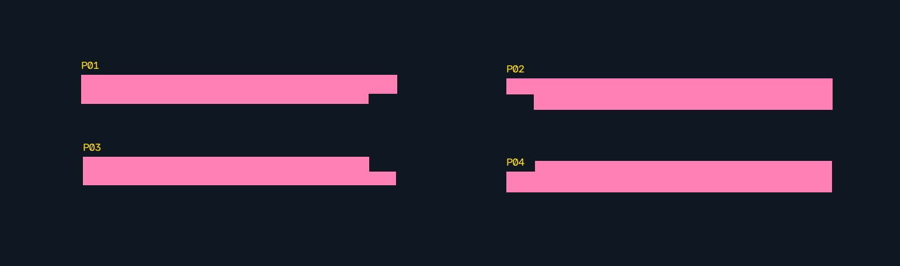
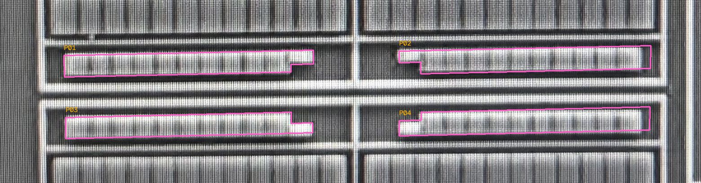
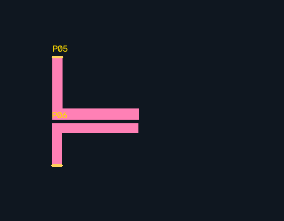
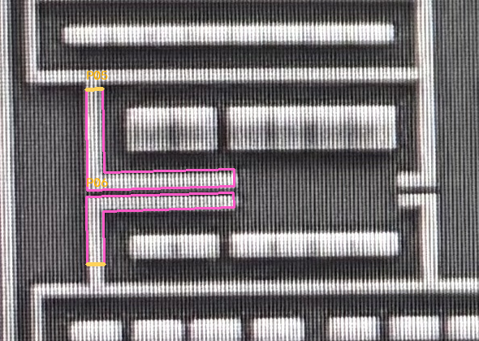

# 阶梯形与折线 AA：正交多边形复核稿 v1

2026-10-18。六个样稿已由用户确认全部正确，验收范围与记录见文末；下文保留首次候选及复核过程。此前环、AA 条、dummy 与 CT 排列的有范围批准保留，不复审、不改动。

[打开六项单页复核入口](../runs/orthogonal-aa-polygons-v1b/index.html)。同页可切换规则版图、AA 原图与 poly 原图回投，调整透明度，查看编号、全幅上下文和延续截口。默认窗口是四个台阶；下拉可切到两段折线。粉色为新增 AA，橙色短截口为继续向外延伸的未建模接续，不是材料断点。

## 一次性核对清单

| 编号 | 候选解释 | 请核对 |
| --- | --- | --- |
| AA-P01 | 上排左，右下缺口台阶 | 台阶方向、凹角与端部是否正确 |
| AA-P02 | 上排右，左下缺口台阶 | 与 P01 的镜像关系、缺口方向是否正确 |
| AA-P03 | 下排左，右上缺口台阶 | 台阶方向及与 P01 的间隙是否正确 |
| AA-P04 | 下排右，左上缺口台阶 | 台阶方向及与 P02 的间隙是否正确 |
| AA-P05 | 上折线 AA 局部段，向上继续到未建模 AA | 折线走向、宽度、与 P06 的间隙是否正确 |
| AA-P06 | 下折线 AA 局部段，向下继续到未建模 AA | 折线走向、宽度、与 P05 的间隙是否正确 |

可按 P01–P06 一次回复正确/修正；无需重新确认旧环与 CT。本轮不增加 CT 孔位、器件身份或电气连接。P05/P06 是局部材料片段，不是新增独立 AA 岛或器件，不根据人工显示窗口定义长期材料/网络边界。

### 四个台阶：规则几何



### 四个台阶：原生 AA 照片回投



### 两段折线：规则几何与原生照片回投





## 数据与实现

- 主数据为 [冻结几何模型](../benchmarks/orthogonal-aa-polygons-v1/model-v1.json)，不是位图轮廓。六个对象有明确顶点、H/V 边约束、源照片原生观察点、回投偏移、来源与状态。
- AI 从原始 AA 照片观察四个台阶和两段折线，录入候选顶点；脚本负责在既有版图坐标中拟合水平/垂直约束并吸附相对网格。没有调用外部视觉模型，也不是已经实现任意图形的自动恢复。
- 对凹多边形保存完整轮廓，外包框只作检索。绘图、像素图生成、AA 落点及分离检查均读取实际多边形，不能把台阶缺口填满。内孔仍作为独立孔洞表示。
- 拒绝自交、塌陷/反向边及未经批准的对象接触/重叠。两段折线的间隙不能因规则化被封住；片段上下截口的延续状态单独保存。
- 从 model-v2-reviewed.json 接续，原有 513 个对象及其状态逐项完全一致。全部仍处于同一 5712×4284 场景空间；现在共有 41 个 AA 几何记录，其中两个为局部片段，不能称为 41 个独立 AA 连通岛。
- 像素图从上述矢量几何渲染。未建模范围不是已确认无材料，不能在局部片段端部自动截断未来网络。

六个新对象规则化角点相对录入原生角点的最大回投位移分别约 4.91、4.72、5.10、4.49、2.92、2.97 px。这是几何拟合引入的位移，不是独立实际边界误差、工艺精度或人工验收阈值。沿用候选全局变换，未重新估计局部镜头畸变；相对单位不换算微米。

## 运行与验证

```bash
.venv/bin/python -m silicon_eye.geometry_reconstruction \
  --root . --spec benchmarks/orthogonal-aa-polygons-v1/spec-v1.json \
  --output runs/一个新目录
```

[输入观察与参数](../benchmarks/orthogonal-aa-polygons-v1/spec-v1.json)、[核查记录](../benchmarks/orthogonal-aa-polygons-v1/result-v1.json)。原始照片、父模型和证据哈希不匹配时失败，不覆盖旧输出或原图。

全项目 279 项测试、相关 Ruff 通过。新增四项测试覆盖：凹多边形缺口在渲染/落点/分离检查中保留、凹角及边方向不反转、错误约束/自交/窄边塌陷拒绝、折线间隙和延续标记保留。原有 AA 像素图与旧算法逐像素一致；全体既有对象和人审字段保持不变。新输出清单哈希、SVG、脚本语法、静态引用与原图哈希检查通过；浏览器交互未实测。

当时质量门为用户验收 P01–P06；当前验收结果与下一步见下节。

## P01–P06 验收通过

用户确认：“P01-P06全部正确。”[原话与有范围裁决](../benchmarks/orthogonal-aa-polygons-v1/human-review-v1.json)绑定冻结模型哈希，确认本次台阶/凹角、折线走向、相对宽度和分离关系。P05/P06 的局部片段与未建模延续语义保留，不据此建立独立 AA 岛或电气断点。

[已审状态模型](../benchmarks/orthogonal-aa-polygons-v1/model-v1-reviewed.json)与 [状态核查记录](../benchmarks/orthogonal-aa-polygons-v1/review-verification-v1.json)另存，未覆盖旧模型/运行记录。519 个几何对象的坐标、算法状态、CT 阵列及延续标记均不变；既有 513 个对象及其人审字段完全一致，仅新增六个对象的人审确认。这次只写入状态，不重复运行软件测试。

矩形、环、重复阵列、台阶和折线的样稿表达均已有有范围的人工复核。它们是同一芯片上的开发/回归基准，不证明全图几何覆盖、精确物理尺寸、像素边界或电气连接通过。

下一步围绕同一完整场景扩展 AA＋CT 几何覆盖，先明确已建模/待建模/未知及片段延续，再按已有几何类型补充。保留已审样本作为回归基准，不再逐项重问。不扩展其他层或封装新 skill。
