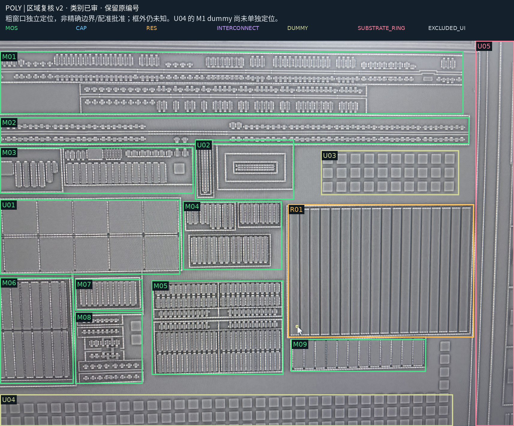

# 八图区域复核 v2：21 项类别已审

> 当前汇总见[区域复核 v3](region-planning-reviewed-v3.md)，新增 C03 金属电容确认；本页原 21 项人审继续保留。

2026-10-18。用户一次性复核全部 21 项；原始候选 v1 与裁决原话保留，不覆盖历史。

[切换八层的复核页](assets/region-planning-v2/review.html) · [裁决原文](../benchmarks/region-planning/eight-photo-regions-human-review-v1.json) · [当前区域记录](../benchmarks/region-planning/eight-photo-regions-reviewed-v2.json) · [原候选 v1](region-planning-v1.md)

| 编号 | 当前类别与解释 | 用户原话 | 后续检查 |
| --- | --- | --- | --- |
| M01 | 上部多排器件阵列 | 正确 | 按子排查 AA/poly 交叠和两类端口，先不定 N/P。 |
| M02 | 中上部两条长阵列 | 正确 | 挑一个单元区分栅、扩散、CT，然后检查整排分组。 |
| M03 | 左中部指状器件组 | 正确 | 先确定单组 gate 与扩散端，再扩展。 |
| M04 | 中部三组指状阵列 | 正确 | 分组建立 AA/poly/CT 对应。 |
| M05 | 下中部器件阵列与首个样稿区 | 正确 | 优先在既有 Q1/Q2 子窗口重建 AA/poly/CT/M1，保留共享扩散与局部 poly 隔离。 |
| M06 | 左下大指状阵列 | 正确 | 选中央完整指对照端部，保留照片外延伸。 |
| M07 | 左下内侧独立指组 | 正确 | 检查一个完整栅/扩散单元及体端接入。 |
| M08 | 左下多排小器件组 | 正确 | 逐子排建立端口候选，不逐 CT 计数。 |
| M09 | 右下长条器件已审区域组 | 正确 | 核对 AA/poly 是否形成栅交叠，再确定类别。 |
| R01 | 右侧大面积平行长条：电阻已审区域 | 正确 | 先检查两条的上下端是否为连续 poly 两端接触，并核对是否实际有 AA；不据条数计电阻。 |
| U01 | 宽 MOS，采用电容接法 | 这个应该是MOS管做电容解法，是mos管，宽mos管 | 按 MOS 几何和端口建模，保留电容用途，不直接标成 MIM/MOM。 |
| U02 | 独立衬底 MOS：横向一个、竖向一个 | 这个是单独衬底的mos管，一横一竖两个mos管 | 保留两个方向子对象，后续分别定位 AA/poly/CT 与体端；不并成单个环形器件。 |
| U03 | dummy AA；M1 上为 dummy M1 | 这个是dummy的AA，M1上是dummy的M1 | 按材料层分别记录 dummy，不作为本区域功能器件自动计数；是否接网仍需证据。 |
| U04 | dummy AA；M1 上为 dummy M1 | 这个也是dummy的AA，M1上是dummy的M1 | AA 窗口保留；M1 仅记录语义裁决，具体定位待查，不复制 AA/poly 框到 M1 或覆盖 C02。 |
| U05 | 衬底环及其上方金属 | 这个是衬底环及其上面的金属 | 后续分别提取环与各金属，连接关系另查。 |
| U06 | 照片上沿界面遮挡 | 这个是照片上沿没有意义，是界面遮挡。 | 输入规范化时生成精确排除区域，保留邻近可见器件与原始照片。 |
| C01 | 右下成对金属梳齿 | 正确 | 保留绿色/橙色电极隔离；复原独立电极及 via 支持。 |
| C02 | 底边多层密集金属阵列 | 正确 | 选择完整单元检查两极和端口；不将整个长框并网。 |
| I01 | M2 主要竖向互连上下文 | 正确 | 后续按导体分段和孔组提取；不按交叉直接连接。 |
| I02 | M3 主要横向互连上下文 | 正确 | 用局部配准建立 M2/M3 接口，先不认全部同网。 |
| I03 | M4 互连及方片混合上下文 | 正确 | 先区分连续线、孤立片与未知；M3/M4 接口另验收。 |

## 裁决边界

- M01–M09、R01、C01/C02、I01–I03：保留区域类别确认，不把互连上下文的全部方片认成有效导体，不从区域框推器件总数。
- U01 的结构为宽 MOS，电容接法是用途；具体 G/S/D/B 连接未在本轮给出，不能因此新增端口短接。
- U02 明确有一横一竖两个独立衬底 MOS，暂按方向记录子对象，未赋予精确掩膜、N/P 或体端网号。
- U03/U04 的 dummy 身份按 AA 与 M1 分层记录，不能把同范围的 poly 像素一并视作 dummy。U04 原候选没有 M1 定位，当前仅记语义，具体位置待查；不把底边 C02 电容阵列覆盖为 dummy。
- U05 为衬底环与上覆金属，但金属是否同网/接地未批准。U06 为界面遮挡，粗观察窗不直接作为逐像素排除掩膜。
- 所有源图、58 个原生粗窗口与原有跨层配准状态保持；无新增全图配准、精确边界、电气边、尺度或泛化评测成绩。
- 页面继续保留一页切换不同层的操作，并增加原始照片入口。

## 下一步

区域类别复核已完成。进入 M05 内既有 Q1/Q2 局部，制作 AA/poly/CT/M1 分层复原样稿，同时保留未知与有效区；需要时补局部对齐。dummy、衬底环和界面遮挡作为不同语义，不并入功能器件。
