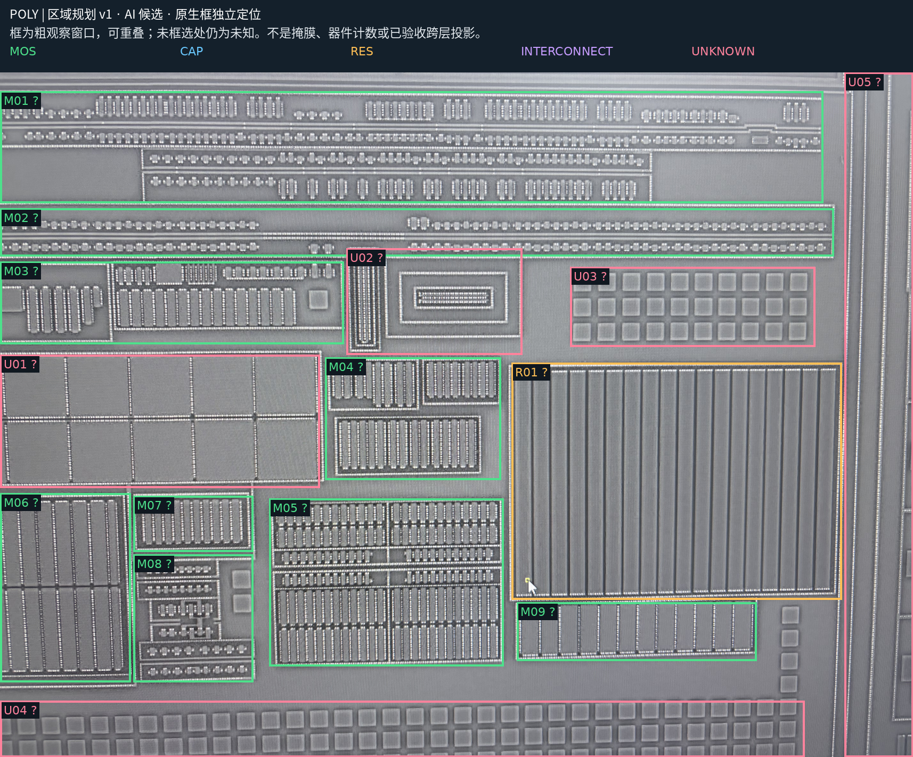

# 八图整体区域划分与区域表 v1

> 历史候选稿。2026-10-18 用户已逐项复核，当前结论见[已审区域 v2](region-planning-reviewed-v2.md)；下文保留首次候选及当时未决问题。

2026-10-18。AI 候选规划，尚待用户核对。参考 PDK 是结构类比，不是本芯片工艺鉴定。

[工艺回查参考](reference/pdk-recognition-guide-v1.md) · [机读区域记录](../benchmarks/region-planning/eight-photo-regions-v1.json) · [八帧交互复核入口](assets/region-planning-v1/review.html)

## 区域表

绿色 MOS、蓝色电容、橙色电阻、紫色互连、粉色未知。M/C/R 是分类候选，不是新增器件编号；各类别可在不同层重叠。所有框均为独立原生粗观察窗口，未框选区域默认未分类，不能当作材料不存在。

| ID | 类别 | 区域 | 照片及原生 xyxy 检查窗 | 判断依据 | 替代解释/未决 | 下一检查 |
| --- | --- | --- | --- | --- | --- | --- |
| M01 | MOS 候选 | 上部多排器件阵列 | poly: [0, 117, 5149, 816]; aa: [0, 366, 5132, 1033]; m1: [0, 267, 5099, 949] | 多排重复指/接触排列，AA 中有对应条带及分段，M1 有阵列接入形态。 | 可能含不同尺寸 MOS、dummy、tap 与局部互连；不将整框认作一个器件。 | 按子排查 AA/poly 交叠和两类端口，先不定 N/P。 |
| M02 | MOS 候选 | 中上部两条长阵列 | poly: [0, 849, 5215, 1149]; aa: [0, 1066, 5215, 1366]; m1: [0, 983, 5132, 1299] | 重复小结构沿两条长带分布，M1 为成排端部接入。 | 含分段器件及横向互连，不能由重复单元数推出器件数。 | 挑一个单元区分栅、扩散、CT，然后检查整排分组。 |
| M03 | MOS 候选 | 左中部指状器件组 | poly: [0, 1183, 2149, 1699]; aa: [0, 1382, 2199, 1882]; m1: [0, 1349, 2116, 1866] | 多组指状结构与接触列，AA 有条状体，M1 有分立竖段。 | 可能包含宽度不同的器件和辅助结构。 | 先确定单组 gate 与扩散端，再扩展。 |
| M04 | MOS 候选 | 中部三组指状阵列 | poly: [2033, 1782, 3133, 2548]; aa: [2133, 1932, 3166, 2665]; m1: [2000, 1899, 3099, 2665] | 成组竖向指及周围接触，AA/M1 均有对应分组形态。 | 组内可能多器件或多指，共享扩散关系待查。 | 分组建立 AA/poly/CT 对应。 |
| M05 | MOS 候选 | 下中部器件阵列与首个样稿区 | poly: [1683, 2665, 3149, 3714]; aa: [1766, 2798, 3183, 3831]; m1: [1683, 2765, 3149, 3831] | 多排重复长短指及 CT 列；框内含既有 Q1/Q2 检查窗口。 | 整体区域尚未逐器件验收；历史局部批准不能外推全框。 | 优先在既有 Q1/Q2 子窗口重建 AA/poly/CT/M1，保留共享扩散与局部 poly 隔离。 |
| M06 | MOS 候选 | 左下大指状阵列 | poly: [0, 2632, 816, 3814]; aa: [0, 2748, 916, 3881]; m1: [0, 2765, 800, 3931] | 较长重复竖指、接触列及相应 AA 条状区域。 | 大尺寸 MOS、多指/并联分组及其他条状器件尚待区分；左侧被视野切断。 | 选中央完整指对照端部，保留照片外延伸。 |
| M07 | MOS 候选 | 左下内侧独立指组 | poly: [833, 2648, 1583, 2998]; aa: [950, 2765, 1633, 3098]; m1: [800, 2765, 1583, 3165] | 独立包围框内有重复竖向指与端部结构。 | 周边环不是独立器件边界，器件归并未知。 | 检查一个完整栅/扩散单元及体端接入。 |
| M08 | MOS 候选 | 左下多排小器件组 | poly: [833, 3015, 1583, 3814]; aa: [950, 3131, 1650, 3898]; m1: [800, 3198, 1583, 3964] | 短横排中可见重复小形态，AA/M1 显示分组结构。 | 可能混合 MOS、tap、dummy；不定器件数量。 | 逐子排建立端口候选，不逐 CT 计数。 |
| M09 | MOS 候选 | 右下长条器件候选组 | poly: [3233, 3315, 4732, 3681]; aa: [3233, 3448, 4732, 3798]; m1: [3199, 3381, 4749, 3781] | 横向框内为宽条及接触/竖向金属排列。 | 宽器件、条状被动结构或组合均需区分。 | 核对 AA/poly 是否形成栅交叠，再确定类别。 |
| R01 | RES 候选 | 右侧大面积平行长条：电阻候选 | poly: [3199, 1816, 5265, 3298]; aa: [3216, 1999, 5265, 3431]; m1: [3149, 1915, 5165, 3398] | poly 图中为规则平行长条；AA 宏观对应区域未显同样密集扩散指，M1 内有分散方片。 | 可能是电阻阵列、其他被动结构、填充或残留；目前不足以排除电容相关结构。 | 先检查两条的上下端是否为连续 poly 两端接触，并核对是否实际有 AA；不据条数计电阻。 |
| U01 | 未知 | 左中宽矩形阵列 | poly: [0, 1766, 2000, 2598]; aa: [0, 1915, 2100, 2715]; m1: [0, 1915, 2000, 2715] | 大块矩形分段和边缘接触，未在本轮辨清独立栅与体的分界。 | 宽 MOS、MOS 电容、其他有源/被动结构或互连组合。 | 用局部 AA/poly 高分辨率检查内部边界及两端，不能仅按矩形定为电容。 |
| U02 | 未知 | 中部同心矩形/环 | poly: [2166, 1099, 3266, 1766]; aa: [2249, 1283, 3299, 1932]; m1: [2133, 1249, 3233, 1882] | 同心矩形及接触边界。 | 保护/tap 环、测试结构、器件或互连；形似环不等于电感或电阻。 | 检查环接触及内部端口，保持未知。 |
| U03 | 未知 | 右上规则方块阵列 | poly: [3566, 1216, 5099, 1716]; aa: [3599, 1416, 5099, 1866]; m1: [3333, 1399, 4832, 1749] | 不同照片中均有规则方块/方片区，但数量和显露形式不同。 | dummy、接触/测试阵列、器件相关结构；不从网格推出电容。 | 先核对哪些层实际保留实体、是否有端口；不强行一对一投影。 |
| U04 | 未知 | 底部方块带及裁切边界 | poly: [0, 3931, 5032, 4284]; aa: [0, 4031, 5032, 4284] | 规则方块带，部分被照片边界截断。 | 填充、保护、测试及器件结构均未排除。 | 核对局部接触和材料，不与上层电容框自动等同。 |
| U05 | 未知 | 右侧边界与框外结构 | poly: [5282, 0, 5712, 4284]; aa: [5299, 183, 5712, 4284]; m1: [5199, 100, 5712, 4284] | 边缘竖框和部分视野外结构。 | 边界/环、金属与邻近单元混合。 | 标记范围不完整；不建立照片外连接。 |
| U06 | 未知 | 源图顶部界面/不明条带 | aa: [0, 0, 5712, 183]; m1: [0, 0, 5712, 83]; m2: [0, 0, 5712, 133]; m3: [0, 0, 5712, 200]; m4: [0, 0, 5712, 100] | 部分照片顶部有软件文字/白条遮挡。 | 覆盖范围边缘仍含可用结构，粗框不是正式无效掩膜。 | 标准输入阶段精确区分 UI 覆盖与可见材料。 |
| C01 | CAP 候选 | 右下成对金属梳齿 | m1: [4699, 3331, 5149, 3714]; m2: [4666, 3365, 5065, 3698]; m3: [4699, 3398, 5149, 3714] | 金属层有两组紧密梳齿；包含此前 B 电极相关已审局部。 | 区域框包含相邻结构，不宣称全部同网或只有一个电容。 | 保留绿色/橙色电极隔离；复原独立电极及 via 支持。 |
| C02 | CAP 候选 | 底边多层密集金属阵列 | m1: [0, 3964, 5132, 4284]; m2: [0, 3964, 5065, 4284]; m3: [0, 3864, 5099, 4284] | 底边可见分块密集平行/折返金属，跨多金属照片存在。 | 可能为多单元金属电容阵列；边界裁切，不定总数、极性和容量。 | 选择完整单元检查两极和端口；不将整个长框并网。 |
| I01 | INTERCONNECT 候选 | M2 主要竖向互连上下文 | m2: [0, 300, 5132, 3931] | 大量竖向金属及端头/孔组。 | 框内也有器件接入和局部电容，非互连纯区。 | 后续按导体分段和孔组提取；不按交叉直接连接。 |
| I02 | INTERCONNECT 候选 | M3 主要横向互连上下文 | m3: [0, 316, 5165, 3831] | 多条长横向金属、分段和接口。 | 局部梳齿/极板与互连可共存。 | 用局部配准建立 M2/M3 接口，先不认全部同网。 |
| I03 | INTERCONNECT 候选 | M4 互连及方片混合上下文 | m4: [0, 300, 4966, 4284] | 高层长竖线与规则方片并存。 | 部分方片可能 dummy/其他结构，不能把全框都标成有效走线。 | 先区分连续线、孤立片与未知；M3/M4 接口另验收。 |

## 本轮重点与下一步

- M05 含既有 Q1/Q2 子窗口，作为首个 AA/poly/CT/M1 复原样稿；历史物理批准不自动扩展到整个 M05。
- R01 是本轮最需要人工核对的类别：观察到长条形态，但两端和材料语义尚未闭合，不宣称电阻阵列已确认。
- C01/C02 是金属电容候选范围；C01 中此前已审的 B 电极关系保留，不因此把整个框升级为确认或与旧电容合并。
- U01/U02/U03/U04 保留未知；普通矩形、同心环和方块网格不能独自证明电阻、电容或 MOS。
- sub/implant 只作原生总览辅助，尚未新增阱、掺杂或器件极性分类。
- 先核对 M05 处理方向和 R01 类别，其他候选可在后续分层提取中逐步修订；不要求逐框或逐 CT 审批。

本轮没有运行自动器件发现模型；这些是当前 Agent 直接观察照片、结合既有复核和 PDK 知识作出的候选。机器检查仅验证来源、框坐标和图文一致性，不代表物理类别已通过。
