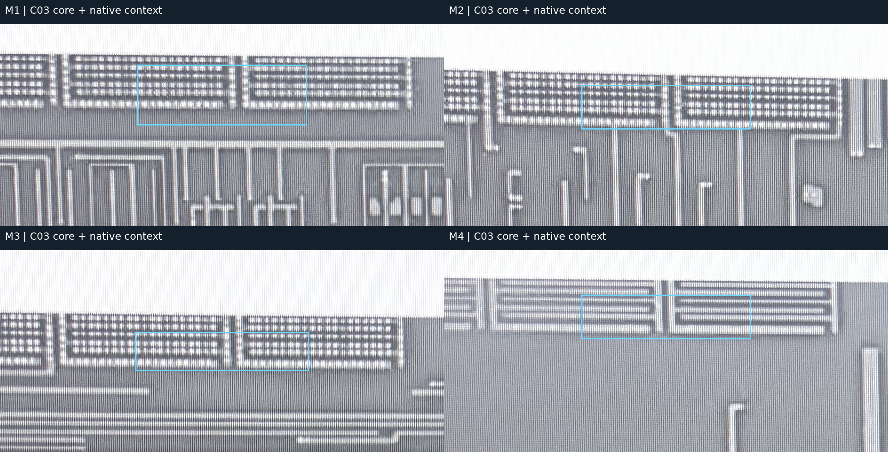

# 区域规划复用验证与 skill 封装判断

2026-10-18。用户授权选择一块未单独分类的区域重走流程，再根据结果判断是否封装。本轮没有重复批准旧 21 项，也没有恢复金属追线。

## 样本与首次判断

选照片上边缘密集金属区，新增区域 ID `SE_RGN_C03`。M1/M2/M3/M4 四个核心窗口逐一检查，与 v2 已有区域框在各自帧上均无面积交叠；具体坐标与交叠核查见[首次观察](../benchmarks/region-skill-validation-v1/first-observation.json)。宽局部图允许包含旧区域，以免丢失空间上下文；核心窗不是完整器件边界。

AI 当前倾向“多层金属电容候选”：多层可见密集平行/折返结构与亮点组。两极、端口、各层同一单元对应及数量未验收；蛇形互连/金属电阻、测试/dummy 尚未完全排除。参考当前 PDK 指南 SKY-D/GF-C 的结构差异，不套用尺寸参数。

- [八层切换、全图与宽局部复核页](assets/region-skill-validation-v1/index.html)。
- [冻结首次判断及验证约定](../benchmarks/region-skill-validation-v1/contract.json)。首次候选未依人工答案修改。
- 同一 Agent 已看过全图和旧人审记录；这是同芯片开发复用试验，**不是独立盲测**。C03 当前没有新的人工参考，物理分类不计准确率。

## 实际验证

将此前临时出图工作缩减为一个参数化复核工具，输入来源/区域 JSON，输出单页多层视图、原样计划和检查记录；不把个案答案写进工具。

[复用检查记录](../benchmarks/region-skill-validation-v1/reuse-validation.json)：

| 检查 | 结果 |
| --- | --- |
| C03 候选按原样保留，八源帧/四核心窗口完成出图 | 通过，脚本不升级分类 |
| 同一个工具重放旧 21 项、58 原生窗口 | 通过，人审记录字节未改 |
| 已有输出目录 | 拒绝覆盖，原产物哈希不变 |
| 错来源哈希、越界窗口、重复对象 | 拒绝，未发布输出 |
| 尝试写入原始 data/ | 拒绝 |
| 七项新增行为测试、相关 Ruff、skill frontmatter 校验 | 通过 |
| 浏览器自动交互 | 未验证：浏览器安全策略拒绝 file: 页面；没有通过其他表面或服务绕过 |
| C03 物理分类正确性/跨芯片表现 | 未测，缺新人工参考/独立输入 |

工具的检查仅覆盖数据与产物行为。新样本的类别仍为候选，原有 21 项人审不改变。

## 封装判断与范围

**可以封装为交互式“区域规划与复核”skill。** 已有真实人审案例，参数化工具可重放不同区域记录，错误输入会显式失败；新区域仍能保留候选和未知。因此封装能力限定为“AI 观察与 PDK 回查→候选记录→统一页面→批量人审→交接”，每次新分类仍走物理复核。

不宣称独立分类泛化已达标，不承诺全自动通过质量门。SKILL.md 和工具一起保存，病例坐标及历史答案不写进通用步骤。

- 项目内可版本化来源：[silicon-eye-region-planning](../skills/silicon-eye-region-planning/SKILL.md)。
- 工具：[build_review.py](../skills/silicon-eye-region-planning/scripts/build_review.py)。
- 持久行为测试：[test_region_review_tool.py](../tests/test_region_review_tool.py)。

已安装到 `/home/zuoky/.codex/skills/silicon-eye-region-planning`，四项维护源文件与安装内容哈希一致；[安装记录](../benchmarks/region-skill-validation-v1/packaging.json)保留范围。可以按路径读取；新会话自动发现/UI 调用尚未实测。安装/发现状态以 CURRENT_TASK.md 为准。工具可直接用本项目 `.venv/bin/python` 运行，无需新增模型、服务或付费调用。

## 唯一需要的新物理裁决

C03：图中上边缘这一类多层密集金属结构，是否可归为金属电容？若不对，指出应为互连、电阻、dummy 或其他即可。无需确认每个孔、器件数量或接线。

该答案用于新增样本的分类复核，不要求重新判断已审的 21 项，也不是维持旧批准的前置条件。

## C03 人审后续（2026-10-18）

用户已确认“C03这一排结构是属于金属电容”。见[当前复核 v3](region-planning-reviewed-v3.md)与[原话记录](../benchmarks/region-skill-validation-v1/C03-human-review-v1.json)。上文未审状态是首次试验时快照，保留原文；当前不再需要该类别裁决。首次分类与人审一致，但不能据一个开发案例称泛化评测通过。下一步恢复 M05/Q1Q2 分层复原样稿。

## 后续职责纠偏：完整视野分层抽取

用户明确区域/器件粗观察用于验证和评估；分层复原应直接面向完整照片，避免切断跨区网络。原 M05/Q1Q2 实施路线已由[顶层 v3](architecture/photo-stack-workflow-v3.md)替代；skill 的源与已安装说明均已同步收窄职责。历史候选、裁决与验证产物保持。
