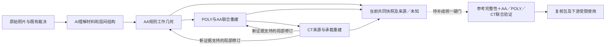

# AA／POLY／CT流程及三层协作全面复查

日期：2026-10-21。审计基线为已推送GitHub的 `6e5bb17fc024f1410f49a580e2e5100eda35e2a6`，远端main与本地HEAD一致。推送包含CT工作层v1、裁决／来源／冻结记录、通用接续修订和相关文档。推送前全量458项测试通过（18.12s），相关Ruff和冻结哈希检查通过。

**结论：当前芯片的三层人机协作重建方法有效，已形成可检查的共同工作几何；三层作为一个可反复接续、自动防退化的工程流程，尚未完全固化。下一步优先统一当前版本和联合质量门，再封装POLY／CT skill，暂不扩大M1实施。**

本轮是复查：没有修改AA／POLY／CT有效模型、源照片、人工裁决、生产代码或已有测试。诊断只在副本或小型合成输入上执行，结果与示意图见[evidence.json](evidence.json)。本报告和审计脚本为本地新增复查产物，没有随第一笔收口提交推送。

## 审计范围及边界

核查了AA skill及质量／工具合同、三层工作流文档、AA局部修订、POLY收口及层间检查、CT联合生成／局部修订、当前快照、来源／未知／别名记录、CLI回放和Agent评测记录。审计不做全图重新识别，不要求用户重验全部孔，也不重新声明真实工艺DRC、像素真值或识别准确率。

当前有效几何在 `benchmarks/ct-work-layer-final-v5/`：334 AA、695 POLY、10287 CT，设计画布5860×4587；原照片5712×4284，不能混作同一坐标。候选对象数量不等于器件数量。5个来源受限范围与两个V3主体截段的历史端子例外继续保留。

## 各层实际流程与成熟程度

| 层 | 已形成的方法 | 脚本／算法职责 | AI及人工职责 | 当前封装状态 |
| --- | --- | --- | --- | --- |
| AA | 从整体材料、MOS／环／电阻内外及真实间隙理解出发；保留直接重建路径，按需用颜色／纹理／结构RF、GrabCut、边缘定位改善细节；最后形成正交几何 | 锁定输入、提候选、拟合、布尔运算、局部变化域、几何／拓扑和前后比较、渲染 | AI决定材料／结构含义及算法是否适用；人裁决关键新歧义，既有裁决沿用 | 仓库内 `silicon-eye-aa-reconstruction` v1人机协作skill；未全局安装，未证明新芯片泛化 |
| POLY | 先辨完整主体及端部，再结合AA沟道、器件类型、匹配排和CT／M1观察；区分普通矩形栅、共用POLY、场区引线和电阻；正交重建与局部修订 | 法向边界辅助、模板候选、阵列拟合、目标AA交叠／伸出、源轮廓、旧ID退休和前后图 | AI负责上下层对应、完整范围、数量和端部；人只处理仍影响结构的新问题 | 工作基线、文档和模块已实现；仓库没有POLY专用skill，完整通用接口尚不统一 |
| CT | 在明确承载材料及原图对应后测亮峰；按同组规则排列孔；明确AA源漏、栅端、环／电阻端；CT反馈可触发有依据的AA／POLY局部新版本 | 原图支持、5px方孔／3px孔距／1px包围及避让、行列节距、同源去重、来源历史、端口盘点、保护检查 | AI确定原图亮点属于哪个端／材料，结合正向规律纠正对应；人裁决方向、共栅、数量等关键歧义 | 工作层v1已工程收口；CT专用skill未封装；仍依赖Agent执行与包装 |

这些模块没有自动调用一个独立视觉Agent去完成全部判断。当前AI工作由交互中的Agent承担，固定操作由Python完成；不应将“Agent编写了脚本”当作“脚本已接入自主AI”。AA已有的A／B0／B1路径与已审回归应继续保留，不能把本次审计当成再次全图提取的理由。

三层真正的工作顺序已经是带反馈的：



区域编号和12个复核窗口仍只是观察／评测索引，不应将材料或网络切成独立小块。正向规则用于帮助识别错误及约束重建，不可代替材料存在和原图对应证据。

## 已有优势，经本轮核查成立

- 原始8图、旧裁决、父模型和冻结记录可追溯；当前AA没有正面积交叠，CT全局几何检查PASS，孔距最小4.4px。33条最后新增孔的来源／几何保护检查可重放。
- CT阶段已经能保留全部父CT、按明确范围改材料、保存源对应before／after和旧ID。右上五到四改用新ID，六指共栅保留子栅记录，材料数与器件数的边界明确。
- 未知、材料身份、精确边界、连接、人审和工程收口没有被强行等同。5个空间来源限制仍开放，V3历史端子关系另列；工程收口未伪称100%物理孔恢复。
- AA的三项已知案例，已分别证明接续、不退化拒绝和一个经人工确认的局部改善；不是只有程序测试。全幅AA的局部双环／非AA间隙裁决也有范围化记录。
- 通用局部修订与前后保护已有实际执行基础，无需推倒这些成果或引入新的重型调度平台。

## 主要发现与优先级

### F01 · P1：当前联合模型不能直接运行原POLY门，引用及结构语义未同步

**直接复现：**对当前 `material-model-v1.json` 调用 `poly_closeout.audit`，立即得到：

```text
KeyError: 'AA2-UPPER-COMPLEX-GUARD-AA-0-split01'
```

该ID在R2已并入 `AA2-UPPER-INNER-B-AA-0`，别名记录保留，但 `guard_AA_ids` 仍引用旧ID。检查器直接按有效AA字典取值，没有解析别名。有效POLY的 `AA_target` 没有悬挂引用；问题是辅助关系未完成接续，不是新发现整片AA几何错误。[poly_closeout.py:290–291](../../../silicon_eye/poly_closeout.py#L290)

只在内存诊断副本中解析环ID后，旧检查器继续报两类结构冲突：

- `G68-P01/P02` 与 `G68-BOTTOM-BUS-01` 的2对重叠。它们是已确认的共用下端POLY桥和成员；旧门按任意两多边形重叠处理，不理解合法的同导体桥关系。
- `G26-P01` 的端部伸出不足。该栅目标已变为阶梯共享AA，旧门使用整个AA外接框；按该栅宽度的局部AA截面检查，上下端实际都满足8px预算。这是目标范围语义未随共享AA修订，不应先拉长栅去消除假警报。

**影响：**三层联合结果能用于人工辅助观察，但旧层检查器尚不能一致消费它。仅修掉一个KeyError还不足以恢复完整质量门。应补引用解析、共用导体成员关系、共享／阶梯AA局部截面语义，然后按同一快照重跑。

### F02 · P1：CT局部修订入口没有自动执行AA／POLY联合结构硬门

`run_local_review_revision` 能改AA／POLY，完成后调用的强制出口是 `require_exportable`，其核心是CT尺寸／孔距／承载／避让检查；没有接入AA层结构检查和POLY的目标／端部关系检查。[ct_transfer.py:753–799](../../../silicon_eye/ct_transfer.py#L753)

本轮用两个小型合成反例验证，没有更改真实图层：

| 反例 | 修改前 | 修改后CT门 | 修改后的相应材料门 |
| --- | --- | --- | --- |
| 保留上端栅CT，把POLY下半截截短，不再跨越整个AA | CT及POLY都PASS | 仍PASS | POLY FAIL：端部伸出不足 |
| 扩大一块AA，使其与应分离的邻居产生400px²交叠，孔本身仍合法 | CT PASS、AA无交叠 | 仍PASS | AA检查发现交叠 |

**影响：**“CT通过”不能保证局部反馈没有损坏下层结构。本次真实修订另有Agent手工附加断言，因此不能据反例判它们已经出错；但这些断言尚未成为通用执行门，换一次任务容易漏掉。

建议新增一条统一的受影响依赖检查链，复用现有检查函数；不需要重写三套算法。先解决F01的合法结构表示，避免将共栅或阶梯结构误挡。

### F03 · P1：全量来源争用检查发现16对旧记录，集中3处热点

以当前全部10287条、同一 `poly` 源帧检查不同承载目标的3px邻域，得到16对记录。与现有新点检查使用相同半径；最后33个新增点没有引入这些冲突。当前通用CT门只全量禁止完全相同的源坐标，近邻检查主要存在于各轮审计配方，覆盖范围未统一。[ct_joint_reconstruction.py:39–42](../../../silicon_eye/ct_joint_reconstruction.py#L39)

| 热点 | 不同目标 | 对数 | 源图 |
| --- | --- | --- | --- |
| SOURCE-1 | 中部MOS环与左侧共享环记录 | 9 | [宽上下文与双重标记](source-hotspot-1-marked.png) |
| SOURCE-2 | G34-P05栅端与邻近环记录 | 6 | [宽上下文与双重标记](source-hotspot-2-marked.png) |
| SOURCE-3 | 左下相邻ROW4-AA3／AA4源漏记录 | 1 | [宽上下文与双重标记](source-hotspot-3-marked.png) |

例如SOURCE-2中一对源点是 `[506,3773]` 与 `[506,3772.875]`，却分别引用POLY栅和AA环。标记图是在原照片自身坐标绘制，未把规则几何投回照片。

**这16对是来源一致性疑点，不是16个漏孔，也不是仅凭距离便能删除记录或改写已审连接的依据。** 当前3px检查不是工艺最小孔距。应按3个热点回看原图、AA／POLY／端部及现有裁决，区分错源点、重复物理观察或需要补充的对应；只修来源即可解决时不动合理设计几何。已审材料及电气事实保留，不重验全部孔。

### F04 · P2：各层最新有效结果未通过同一种机器接口接续

当前共同快照含AA334／POLY695；而历史AA回放输出AA337，历史POLY回放输出POLY700。这是后续明确修订的结果，不是计数越少越好或旧回放“跑坏了”。

- 从AA337到当前：四个旧AA ID退休、一个共享AA ID新增，另14个共同ID记录有变化；包括已确认误报退休、共享AA和R2连续AA。不能用旧AA回放覆盖它们。
- 从POLY工作基线到当前：包含共栅导体合并、端部桥及五栅到四栅修订；原子材料对象、子栅身份和器件ID必须分别维护。
- `aa_layer_revision` 从 `objects` 读取AA，并依赖来源／投影结构；当前联合模型的 `objects` 是POLY，AA在 `AA_objects`，没有同一接口所需全部字段。直接将最新联合模型换进AA旧spec并不可行。[aa_layer_revision.py:303–329](../../../silicon_eye/aa_layer_revision.py#L303)
- 合并AA保留了原A的 `source_geometry`、合并来源档案及明确范围说明；旧 `source_polygon` 优先读取单个 `source_geometry`，不会自动理解合并档案。不经适配就画来源叠加，会漏掉合并范围。[aa_completion.py:86–93](../../../silicon_eye/aa_completion.py#L86)

目前靠CURRENT_TASK、Agent阅读和逐轮spec选对版本，不能称为各skill天然无损互通。应指定一个三层共同快照清单，并补最薄的输入／输出适配；保留旧冻结基线，不回写旧批准。

### F05 · P2：几何CLI可重放，但完整收口包仍依赖现场包装

本轮实际执行了三条已有命令，输出到新的 `runs/workflow-audit-6e5bb17-*-replay`：

| 路径 | 重放结果 | 正确解释 |
| --- | --- | --- |
| AA `aa_layer_revision` + spec-v3 | 技术门通过，输出337 AA及当时待审信息 | 复现历史，不重新提出后来已关闭的双环问题 |
| POLY `poly_closeout` + v3 spec | 700 POLY、几何PASS、READY_FOR_CT | 复现当时基线，不包含后来的CT反馈修改 |
| CT `ct_transfer` + final-v5 spec | 10287 CT，AA／POLY／CT对象与冻结成品完全一致 | 几何可重放；原始CLI模型没有最终stage_status／受限清单引用 |

原始CT回放保留5个 `unknown_scopes`，但通用页面只读取 `sites` 画未知孔框；空间来源限制、最终工程状态、全幅开关和使用约束由审计包装补入。`use-contract`已经如实说明它是交接数据，当前没有网络导出器强制执行。[ct_transfer.py:818–852](../../../silicon_eye/ct_transfer.py#L818)

这不是“现有命令无法复现几何”，也不是“限制已经丢失”；差距是缺少稳定的完整交付入口。封装skill前应让统一复核包生成器自动携带模型版本、限制、人审范围和阶段状态，校验后输出，避免每次由Agent重新拼装页面和门状态。将来M1／追网入口必须消费限制，不能只看一个PASS。

### F06 · P2：软件回归较扎实，Agent效果评测仍不足

AA三项已知案例经局部人审通过，能证明该范围的接续、改善和拒绝退化。不能将其说成多模型独立测试或新芯片泛化。`agent-eval/index.json` 仍只有同一芯片的V3／ROI2两组历史种子，每组1个任务、10条部分参考，均记录0次Agent运行；POLY一次“5判6”的失败已保存，这一点应保留。

缺少按同一输入、模型／提示版本保存的未经人工修正输出、固定错误类型、人工纠正次数和新留出范围。458项程序测试不回答“换一次Agent后，是否仍能认对栅、环、共用扩散、端部和未知”。

建议先做少量任务级回归：双环隔离、暗AA内部连续、POLY完整端部、四／六指数量、共栅桥、CT原图归属及受限区保持。开发回归与留出验证分别标记；不要再将每张层照片算一个独立任务，或将已有人工答案喂给待测Agent。无需现在搭评测平台。

### F07 · P3：可维护性还有三项轻量整理

- POLY／CT文档前部仍包含早期局部工具或历史状态，后文追加纠偏；入口虽指向CURRENT_TASK，仍应给“当前协议”与“历史诊断”清楚导航，避免新Agent抄用旧方式。保留原文证据，不删除历史。
- `poly_gate_matching`直接依赖SciPy，核心依赖未显式列出；当前环境由算法扩展依赖具备它。本轮三条重放均成功，纯净环境安装未实测；将来应明确算法工具所需extra，而不据当前venv成功认定新环境可用。
- 本次推送新增351个文件、约1124万行；四组新包工作树合计约439.7MiB。Git会去重／压缩，不能把该数当上传流量。后续展示资产和模型副本可共享引用，保留冻结证据，避免每轮复制整幅图片；这是维护成本问题，不应挤占材料质量优先级。

## 分工是否合理

分工方向合理，执行还需要接口与验收自动化来约束：

| 角色 | 应继续承担 | 当前应避免 |
| --- | --- | --- |
| AI | 全幅材料理解、上下层对应、规则解释、分歧判断、错误定位与影响范围 | 按某个配方能通过就认定识别正确，或为规避冲突改层／改数量 |
| 脚本 | 坐标与哈希、候选计算、规则几何、引用解析、固定质量门、差异／复核包生成 | 把亮点或相似度直接升级为端子身份，用原图波纹直接当GDS边界 |
| 人 | 真正无法从现有证据判定的关键结构／连接和最终采用范围 | 反复确认已经裁决的同一事实，逐孔承担算法／接口漏检 |

照片对应可以有不确定性，GDS规则图仍须保持正交、间距和拓扑；两种要求不互相替代。若根据CT修订POLY／AA，影响检查应沿依赖回到被改层，不应把“先提AA、再提POLY、再提CT”误实现为不可反馈的单向冻结。

## 建议下一步：先补三层接续与联合门，不扩大提取范围

按顺序做三个可独立验收的小任务：

1. **共同版本及关系接续。** 指定当前AA／POLY／CT、别名／退休ID、子栅、原生来源、限制和批准范围；让任一局部修订接入当前快照。验收时旧退休ID不复活，未改对象完整相同，环ID与桥成员均可解析；旧历史命令不冒充当前版本。
2. **联合质量门及3处来源热点。** 将AA几何／隔离、POLY局部跨AA／端部、同导体桥、CT规则和源点争用组合为适用的硬门。上面两个反例应被拦住，合法U10桥和G26局部截面不误挡；回查16对来源仅改有证据的范围。证据不足者保留相应未知，不临时补孔或改网。
3. **统一复核包与skill验证。** 用当前芯片完成一次“同一快照→一处新修订→联合检查→限制随包→前后保护”的闭环，再封装POLY／CT；AA skill补共同快照适配。附少量固定Agent任务及一次留出验证，重复成功后再扩展M1。

不要求重训AA、不重验全部CT、不先建Supervisor或通用DAG、不重做已审照片。算法选型可以保持按问题选择；近期最有价值的开发工作是防止已经做对的层在反馈、回放或换Agent时失去标准。

## 重放与交接

审计配方：`PYTHONPATH=. .venv/bin/python docs/reviews/aa-poly-ct-audit-2026-10-21.py --output runs/新的流程审计目录`。它读取固定版本及上述三个已有CLI回放目录，输出检查与3个来源热点截图，不改输入；当前审计证据在本目录。原始CT工作层和冻结清单检查均保持不变。

首次在新检出中复现，先在项目环境运行以下命令；输出目录必须不存在，已有回放不覆盖。AA／POLY为历史回放，不能作为当前联合工作版本采用：

```bash
.venv/bin/python -m silicon_eye.aa_layer_revision --root . --spec benchmarks/aa-full-frame-workflow-v1/spec-v3.json --output runs/workflow-audit-6e5bb17-aa-replay
.venv/bin/python -m silicon_eye.poly_closeout --root . --spec benchmarks/poly-closeout-v3/spec-v1.json --output runs/workflow-audit-6e5bb17-poly-replay
.venv/bin/python -m silicon_eye.ct_transfer --spec benchmarks/ct-work-layer-final-v5/spec-v1.json --output runs/workflow-audit-6e5bb17-ct-replay
```

人工下一步无需重新批准所有AA／POLY／CT。若继续开发，先执行上述任务1和2，再决定skill封装；来源热点若确需裁决，应先完成AI自身回查，准备对应上下层宽视野后集中提交。本次复查没有替用户裁决这些疑点。
